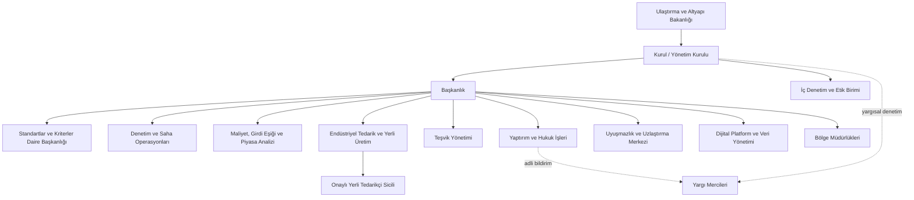

# Konut İnşaatı Standardizasyon ve Regülasyon Platformu — Kurumsal Model

> Taslak kavram belgesidir. Hukuki metin değildir; mevzuat atıfları ve sayısal değerler ileride uzman görüşüyle netleştirilecektir.

## 1. Amaç ve Vizyon

**Ana misyon:** Konut inşaatında **girdi maliyetlerini (işçilik hariç) belirli bir eşikte tutmak**; böylece **düşük maliyetle yüksek dayanıklı yapı** üretimini mümkün kılmak. Bu misyon, iç ranttan bağımsız, ölçekli ve çok üreticili **yerli endüstriyel tedarik** yapısıyla desteklenir.

**Amaç:** Küçük ve orta ölçekli konut inşaatlarında yapım kalitesini belirli kriterler altında standartlaştırmak; maliyet ve kâr marjlarını şeffaf ve öngörülebilir kılmak; standartlara uyanı teşvik eden, uymayanı yaptırımla düzelten bir regülatör platform kurmak.

**Vizyon:** Her konutun güvenli, dayanıklı ve adil fiyatla üretildiği; yerli girdilere dayanan, vatandaşın, yüklenicinin ve devletin aynı ölçütlerle konuştuğu kurumsal bir standart ekosistemi.

**Temel ilkeler:** Kamu güvenliği, maliyet disiplini, şeffaflık, ölçülülük, eşit muamele, hesap verebilirlik, veriye dayalı karar.

## 2. Hukuki Statü ve Bağlılık

- Kurum, **Ulaştırma ve Altyapı Bakanlığına bağlı / ilişkili** bir kamu tüzel kişiliği olarak tasarlanır.
- Statü seçenekleri (karara bağlanacak):
  1. Bakanlığa bağlı genel müdürlük düzeyinde birim,
  2. Bakanlıkla ilişkili, idari ve mali özerkliğe sahip düzenleyici kurum,
  3. Kamu-özel ortak yönetişimli platform (kamu denetimi altında).
- Kuruluş ve yetkilerin bir **kanunla** düzenlenmesi gerekir; yaptırım ve fiyat belirleme yetkileri ancak yasal dayanakla kullanılabilir.
- Not: Konut/yapı denetimi alanında mevcut yetkili kurumlarla görev paylaşımı ayrıca netleştirilmelidir (bkz. Bölüm 12).

## 3. Regülatör Yetkileri

| Yetki alanı | Açıklama |
|---|---|
| Düzenleme | Teknik standart, kriter ve uygulama yönetmeliklerini çıkarma |
| Yetkilendirme | Yüklenici, müteahhit, tedarikçi ve denetçileri sicile kaydetme, sınıflandırma, lisanslama |
| İzleme | Proje, şantiye, tedarik ve teslim aşamalarında veri toplama ve raporlama |
| Denetim | Planlı, risk bazlı ve şikâyet üzerine denetim |
| Fiyat/marj düzenleme | Girdi maliyeti eşiği, referans maliyet ve kâr marjı bantlarını belirleme (Bölüm 9) |
| Teşvik | Yerli girdi şartlı seçici teşvik kriterlerini belirleme ve uygulama (Bölüm 7) |
| Endüstriyel koordinasyon | Standart yapı bileşenleri ve yerli tedarik ağını geliştirme (Bölüm 10) |
| Yaptırım | Kademeli idari yaptırım uygulama (Bölüm 8) |
| Uyuşmazlık | Taraflar arası ilk aşama uzlaştırma / hakemlik |

## 4. Denetim ve Yargı/Adalet İlişkisi

- **İç denetim:** Kurum içi teftiş ve etik birimi; denetçi rotasyonu ve çıkar çatışması beyanı.
- **Dış denetim:** Kamu mali denetimine tabi olma, yıllık faaliyet raporunun kamuya açıklanması.
- **Yargısal denetim:** Kurumun tüm kararları idari yargı denetimine açıktır; karar gerekçeli ve itiraz yolu gösterilmiş şekilde tebliğ edilir.
- **Adalet ile bağ:**
  - Suç şüphesi doğuran tespitlerin (ör. can güvenliğini tehlikeye atan ihmal, sahtecilik) yetkili adli mercilere bildirilmesi,
  - Mahkemelere ve bilirkişilik süreçlerine teknik veri ve rapor desteği,
  - Tüketici uyuşmazlıklarında standart uyum raporlarının delil niteliğinde kullanılabilmesi,
  - Kurum bünyesinde **uzlaştırma/arabuluculuk** mekanizması ile yargı yükünün azaltılması.

## 5. Kapsam: KOBİ Ölçekli Konut İnşaatı

- **Kapsamda:** Küçük ve orta ölçekli müteahhitlerce yapılan müstakil ev, az katlı apartman ve küçük konut siteleri; bu yapılara girdi sağlayan tedarikçiler.
- **Kapsam dışı (ilk faz):** Büyük ölçekli toplu konut projeleri, ticari/sanayi yapıları, altyapı projeleri.
- Ölçek eşikleri (bina sayısı, inşaat alanı, yüklenici cirosu vb.) pilot çalışma sonrası belirlenecektir.
- Yaşam döngüsü: proje → ruhsat sonrası uygulama → tedarik → şantiye → teslim → garanti dönemi.

## 6. Standartlar ve Kriterler

Her başlık için ölçülebilir göstergeler, asgari eşikler ve kalite sınıfları (ör. A/B/C) tanımlanır.

1. **Deprem dayanımı ve taşıyıcı sistem:** Zemin etüdü, statik proje uyumu, beton/donatı testleri, uygulama kontrolleri.
2. **Malzeme kalitesi:** Belgeli ve izlenebilir malzeme kullanımı, numune ve laboratuvar testleri, tedarik zinciri kaydı.
3. **Enerji verimliliği:** Yalıtım, pencere/doğrama performansı, ısıtma-soğutma sistemleri, yenilenebilir enerji entegrasyonu.
4. **Yangın güvenliği:** Kaçış yolları, malzeme yanmazlık sınıfı, algılama sistemleri.
5. **Su yalıtımı ve tesisat:** Sıhhi tesisat, drenaj, nem ve sızıntı kontrolü.
6. **Erişilebilirlik:** Engelli ve yaşlı kullanımına uygunluk.
7. **İşçi sağlığı ve şantiye güvenliği.**
8. **Çevre ve atık yönetimi:** İnşaat atıkları, toz/gürültü kontrolü.
9. **İşçilik ve teslim kalitesi:** Kontrol listeleri, teslim tutanağı, kusur giderme süreleri.
10. **Şeffaflık ve dokümantasyon:** Dijital yapı dosyası (proje, test, fotoğraf, fatura ve tedarik kayıtları).
11. **Dayanıklılık/maliyet etkinliği:** Birim maliyet başına beklenen yapı ömrü ve bakım ihtiyacı göstergeleri.

## 7. Seçici Teşvik Mekanizması

Teşvikler herkese değil, **performansı kanıtlanmış** yüklenicilere ve projelere verilir ve **yerli girdilerle çalışır**.

- **Yerli girdi şartı:** Teşvikten yararlanmak için projede kullanılan malzeme ve bileşenlerin belirlenecek bir oranının yerli üretim olması ve platform tarafından onaylı tedarikçilerden alınması.
- **Uygunluk:** Standart uyum puanı belirli eşiğin üzerinde olan, sicili temiz, girdi maliyeti eşiğine uyan yükleniciler.
- **Araçlar (örnek):** Harç/vergi kolaylıkları, kamu destekli kredi faiz desteği, hızlı izin süreci, kamu projelerinde öncelik, "Onaylı Yapı" kalite etiketi; yerli üreticiler için kapasite artırımı ve standart bileşen üretimine yönelik destekler.
- **Puanlama:** Kalite skoru, yerli girdi oranı, girdi maliyeti eşiğine uyum, şikâyet geçmişi, zamanında teslim, maliyet şeffaflığı, enerji sınıfı.
- **Geri alma:** Sonradan uyumsuzluk (ör. yerli girdi beyanının gerçeğe aykırı olması) tespit edilirse teşvik iptal edilir ve geri talep edilebilir.

## 8. Yaptırım Kademeleri

| Kademe | Yaptırım | Tetikleyici (örnek) |
|---|---|---|
| 1 | Uyarı ve düzeltme süresi | Küçük, can güvenliğini etkilemeyen eksiklik |
| 2 | İdari para cezası | Süresinde giderilmeyen veya tekrarlayan uyumsuzluk; gerekçesiz eşik aşımı |
| 3 | Teşviklerin askıya alınması/iptali | Teşvik koşullarının veya yerli girdi şartının ihlali |
| 4 | İş durdurma | Can ve mal güvenliğine yönelik ciddi risk |
| 5 | Sicil puanı düşürme, faaliyet kısıtlaması | Ağır veya sistematik ihlal |
| 6 | Lisans/yetki iptali ve adli bildirim | Kasıt, sahtecilik, ağır ihmal |

Tüm yaptırımlar ölçülülük ilkesine göre, savunma hakkı tanınarak ve gerekçeli kararla uygulanır.

## 9. Maliyet ve Kâr Marjı Belirleme Yöntemi

### 9.1 Girdi maliyeti eşiği (işçilik hariç)

- Platformun ana aracıdır. **İşçilik dışındaki girdiler** (malzeme, yapı bileşenleri, ekipman, nakliye, tedarik ve ara hizmet maliyetleri) için yapı sınıfı ve bölge bazında **m² başına azami girdi maliyeti eşiği** belirlenir.
- İşçilik eşiğe dahil edilmez; işçilik ücretleri ayrı izlenir ve eşik üzerinden baskılanmaz.
- Eşik, **asgari dayanıklılık ve kalite standartlarını karşılayan** referans girdi sepetine göre hesaplanır; eşik, kaliteden ödün verilerek tutturulamaz.
- Eşiğe uyum; onaylı yerli tedarikçilerden standart bileşen alımı, toplu/ölçekli tedarik ve tedarik zincirindeki aracı rantının azaltılması ile sağlanır (Bölüm 10).
- Eşik aşımı yalnızca gerekçeli istisna başvurusuyla (zemin, erişim, özel tasarım vb.) mümkündür.

### 9.2 Referans maliyet ve marj

1. **Referans birim maliyet:** Bölge, yapı sınıfı ve kalite sınıfına göre m² bazında malzeme, işçilik, ekipman, genel gider ve finansman kalemlerinden oluşan maliyet modeli.
2. **Veri kaynakları:** Kayıtlı projelerin gerçekleşen maliyet verileri, onaylı tedarikçi fiyatları, malzeme fiyat endeksleri, işçilik ücretleri, piyasa araştırmaları.
3. **Güncelleme:** Periyodik (ör. üç aylık) ve olağanüstü fiyat hareketlerinde ara güncelleme.
4. **Kâr marjı bandı:** Asgari ve azami marj içeren bir **bant** yaklaşımı; sabit fiyat yerine aralık belirlenmesi önerilir.
5. **Kalite primi:** Daha yüksek kalite sınıfı ve enerji performansı için ilave marj izni.
6. **Şeffaflık:** Satış/sözleşme belgelerinde maliyet sınıfı, girdi eşiğine uyum durumu ve kalite etiketinin gösterilmesi.
7. **İtiraz:** Yüklenicilerin özel koşulları için gerekçeli sapma başvurusu.

## 10. Endüstriyel Tedarik ve Yerli Üretim

Girdi maliyeti eşiğinin sürdürülebilir olması için platformun bir **endüstriyel ayağı** bulunur.

- **Rantı azaltma:** Malzeme ve tedarikte aracı katmanlarının ve spekülatif fiyatlamanın azaltılması; üreticiden şantiyeye kısa ve izlenebilir tedarik zinciri; fiyat oluşumunun iç ranttan bağımsız hale getirilmesi.
- **Çoklu üretici:** Tek tedarikçi bağımlılığı ve tekelleşmeyi önlemek için her kritik girdi kaleminde birden fazla onaylı yerli üretici; bölgesel dağılım ile nakliye maliyetinin düşürülmesi.
- **Ölçek ekonomisi:** Küçük ve orta ölçekli yüklenicilerin taleplerinin platform üzerinden birleştirilmesi (toplu/çerçeve alım), üreticilere öngörülebilir talep sağlanması.
- **Standart yapı bileşenleri / prefabrikasyon:** Taşıyıcı elemanlar, duvar panelleri, doğrama, tesisat modülleri gibi bileşenlerin standart ölçü ve kataloglarla tanımlanması; seri ve çoklu üretime uygun, deprem ve dayanıklılık testinden geçmiş prefabrik çözümler.
- **Tedarik zinciri şeffaflığı:** Onaylı tedarikçi sicili, ürün menşe ve test belgelerinin dijital kaydı, parti bazlı izlenebilirlik, fiyatların platformda görünür olması.
- **Kalite güvencesi:** Üreticilerde periyodik üretim denetimi ve numune testleri; standart dışı ürünün sicilden çıkarılması.

## 11. Organizasyon Şeması

## 12. Açık Sorular ve Riskler

- **Rekabet hukuku:** Kâr marjı/fiyat ve girdi eşiği belirleme, serbest piyasa ve rekabet kurallarıyla çatışabilir; bant yaklaşımı ve rekabet otoritesiyle koordinasyon gerekir.
- **Uluslararası ticaret kuralları:** Yerli girdi şartına bağlı teşvikler, Türkiye'nin taraf olduğu uluslararası ticaret anlaşmaları ve gümrük birliği yükümlülükleriyle çelişebilir; teşvik tasarımının bu açıdan hukuki incelemesi gerekir.
- **Yerli tedarik kapasitesi:** Bazı girdi kalemlerinde yerli üretim kapasitesi, kalite veya çeşitlilik yetersiz olabilir; bu durumda eşik tutturulamayabilir veya fiyatlar yükselebilir. Kademeli yerli oran, geçiş istisnaları ve kapasite yatırımları planlanmalı.
- **Eşik ve kalite dengesi:** Maliyet eşiği baskısının kaliteden ödün verilmesine yol açmaması için sıkı test ve denetim şart.
- **Mevcut kurumlarla örtüşme:** Yapı denetimi, imar, standardizasyon, sanayi ve tüketici koruma alanında yetkili kurumlarla görev çakışması; hangi bakanlığın asıl yetkili olacağı netleştirilmeli.
- **Yasal dayanak:** Yaptırım, fiyat ve eşik düzenleme yetkisi için kanuni düzenleme şart.
- **Bürokratik yük:** KOBİ'ler için uyum maliyeti; sade süreçler ve dijital başvuru önerilir.
- **Kayıt dışılık:** Sıkı kurallar kayıt dışı inşaatı artırabilir.
- **Kurumsal bağımsızlık ve yolsuzluk riski:** Özellikle tedarikçi onayı ve teşvik dağıtımında; denetçi rotasyonu, şeffaf karar yayımı, dış denetim.
- **Veri kalitesi:** Maliyet modelinin güvenilirliği veri toplama altyapısına bağlı.
- **Finansman:** Kurumun bütçesi (genel bütçe, harç, katkı payı) belirlenmeli.
- **Geçiş süreci:** Pilot bölge ile başlama ve kademeli yaygınlaştırma.

## 13. Sonraki Adımlar

1. Paydaş görüşmeleri (bakanlıklar, meslek odaları, müteahhit birlikleri, yapı malzemesi üreticileri, tüketici örgütleri)
2. Mevzuat, ticaret anlaşmaları ve kurum haritası analizi
3. Yerli tedarik kapasitesi envanteri ve standart bileşen kataloğu taslağı
4. Pilot kriter seti, girdi maliyeti eşiği ve maliyet modeli taslağı
5. Pilot bölge uygulaması ve değerlendirme
