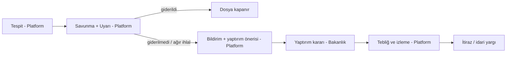
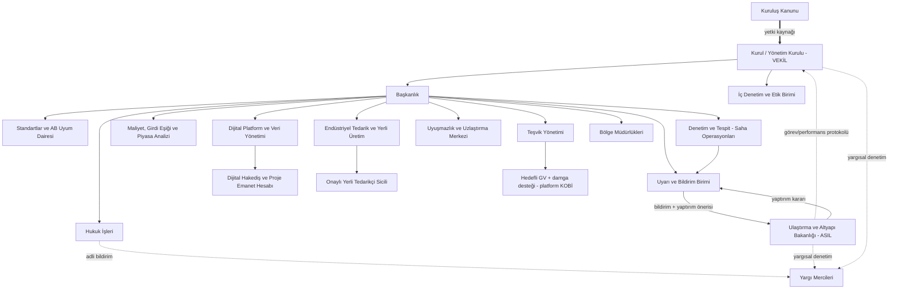

# Konut İnşaatı Standardizasyon ve Regülasyon Platformu — Kurumsal Model

> Taslak kavram belgesidir. Hukuki metin değildir; mevzuat atıfları ve sayısal değerler ileride uzman görüşüyle netleştirilecektir.

> **Simülasyon:** %30 marj tavanı ve fiyat kurallarının gerçek verilerle backtest'i için bkz. [simulasyon/SIMULASYON.md](simulasyon/SIMULASYON.md); güncel kural (6 aylık maliyet/kur bazlı güncelleme) için [simulasyon/ENDEKS_6AY.md](simulasyon/ENDEKS_6AY.md); G2/G3 yerlileştirme değerlendirmesi için [simulasyon/YERLILESTIRME_2YIL.md](simulasyon/YERLILESTIRME_2YIL.md).

## 1. Amaç ve Vizyon

**Ana misyon:** Konut inşaatında **girdi maliyetlerini (işçilik hariç) belirli bir eşikte tutmak**; böylece **düşük maliyetle yüksek dayanıklı yapı** üretimini mümkün kılmak. Bu misyon, iç ranttan bağımsız, ölçekli ve çok üreticili **yerli endüstriyel tedarik** yapısıyla desteklenir.

**Amaç:** Küçük ve orta ölçekli konut inşaatlarında yapım kalitesini **AB/uluslararası standartları teknik taban alan, Türkiye'ye özelleştirilmiş ulusal standart** altında standartlaştırmak; maliyet ve kâr marjlarını şeffaf ve öngörülebilir kılmak; standartlara uyanı teşvik eden, uymayanı uyarı–bildirim–yaptırım zinciriyle düzelten bir regülatör platform kurmak.

**Vizyon:** Her konutun güvenli, dayanıklı ve adil fiyatla üretildiği; yerli girdilere dayanan, teknik olarak uluslararası standartlarla uyumlu ama Türkiye'ye özgü, vatandaşın, yüklenicinin ve devletin aynı ölçütlerle konuştuğu kurumsal bir standart ekosistemi.

**Temel ilkeler:** Kamu güvenliği, uluslararası uyum, maliyet disiplini, şeffaflık, ölçülülük, eşit muamele, hesap verebilirlik, veriye dayalı karar.

## 2. Hukuki Statü ve Bağlılık

- **Yetkinin kaynağı:** Platformun yetkisi başka kurumlardan **devredilmez**; doğrudan kendi **kuruluş kanunundan** doğar. Görev ve yetkiler bu kanunda sayılır.
- **Bakanlıkla ilişki — asıl–vekil modeli:**
  - **Asıl (principal):** Ulaştırma ve Altyapı Bakanlığı; politika hedeflerini belirler, nihai idari yaptırım kararlarını verir, platformun performansını denetler.
  - **Vekil (agent):** Platform; kanundan aldığı yetkiyle standartları uygular, tespit yapar, uyarır ve bakanlığa bildirimde bulunur.
  - İlişki, kanun ve bakanlıkla imzalanacak bir **görev/performans protokolü** ile tanımlanır (hedefler, raporlama, süreler, bilgi akışı).
  - Bakanlık, platformun teknik tespitlerine bireysel dosya bazında talimat veremez; vesayet denetimi kural ve performans düzeyinde kalır (öneri).
- Statü seçenekleri (karara bağlanacak):
  1. Bakanlıkla ilişkili, idari ve mali özerkliğe sahip düzenleyici kurum,
  2. Bakanlığa bağlı özel bütçeli kurum,
  3. Kamu-özel ortak yönetişimli platform (kamu denetimi altında).
- Mevcut yetkili kurumlarla görev paylaşımı ayrıca netleştirilmelidir (bkz. Bölüm 12).

## 3. Regülatör Yetkileri

| Yetki alanı | Açıklama | Kullanan |
|---|---|---|
| Düzenleme | AB/uluslararası teknik taban üzerine Türkiye'ye özelleştirilmiş ulusal standardı (yerli girdi şartı dahil) ve kalite sınıflarını belirleme | Platform |
| Yetkilendirme | Yüklenici, tedarikçi ve denetçi sicili, sınıflandırma | Platform |
| İzleme | Proje, şantiye, tedarik ve teslim verisi toplama, raporlama | Platform |
| Denetim ve tespit | Planlı, risk bazlı ve şikâyet üzerine denetim; uyumsuzluk tespiti | Platform |
| Uyarı | Düzeltme talebi ve süre verme | Platform |
| Bildirim | Uyumsuzlukların yaptırım önerisiyle bakanlığa bildirilmesi | Platform → Bakanlık |
| İdari yaptırım | Para cezası, iş durdurma, lisans iptali vb. | Bakanlık (bkz. Bölüm 8, açık soru) |
| Fiyat/marj düzenleme | Girdi maliyeti eşiği, referans maliyet ve kâr marjı bantları (Bölüm 9) | Platform (bakanlık onayı tartışmalı) |
| Teşvik | Yerli girdi şartlı seçici teşvik (Bölüm 7) | Platform |
| Endüstriyel koordinasyon | Standart bileşenler ve yerli tedarik ağı (Bölüm 10) | Platform |
| Uyuşmazlık | İlk aşama uzlaştırma / hakemlik | Platform |

## 4. Denetim ve Yargı/Adalet İlişkisi

- **İç denetim:** Kurum içi teftiş ve etik birimi; denetçi rotasyonu ve çıkar çatışması beyanı.
- **Dış denetim:** Kamu mali denetimine tabi olma, yıllık faaliyet raporunun kamuya açıklanması; asıl–vekil protokolü kapsamında bakanlığa performans raporu.
- **Yargısal denetim:** Platformun ve bakanlığın tüm kararları idari yargı denetimine açıktır; karar gerekçeli ve itiraz yolu gösterilmiş şekilde tebliğ edilir.
- **Adalet ile bağ:**
  - Suç şüphesi doğuran tespitlerin (ör. can güvenliğini tehlikeye atan ihmal, sahtecilik) yetkili adli mercilere bildirilmesi,
  - Mahkemelere ve bilirkişilik süreçlerine teknik veri ve rapor desteği,
  - Tüketici uyuşmazlıklarında standart uyum raporlarının delil niteliğinde kullanılabilmesi,
  - Kurum bünyesinde **uzlaştırma/arabuluculuk** mekanizması.

## 5. Kapsam: KOBİ Ölçekli Konut İnşaatı

- **Kapsamda:** Küçük ve orta ölçekli müteahhitlerce yapılan müstakil ev, az katlı apartman ve küçük konut siteleri; bu yapılara girdi sağlayan tedarikçiler.
- **Kapsam dışı (ilk faz):** Büyük ölçekli toplu konut projeleri, ticari/sanayi yapıları, altyapı projeleri.
- Ölçek eşikleri pilot çalışma sonrası belirlenecektir.
- Yaşam döngüsü: proje → ruhsat sonrası uygulama → tedarik → şantiye → teslim → garanti dönemi.

## 6. Standartlar ve Kriterler

### 6.1 Temel ilke: Uluslararası teknik taban + Türkiye'ye özelleştirme

Platformun standardı **AB standardı değildir**; içeriği büyük ölçüde AB/uluslararası standartların kopyası olsa bile, **AB/uluslararası standartları teknik taban alan ve Türkiye'ye özelleştirilmiş bir ulusal standart**tır. Yapısı iki katmanlıdır:

1. **Teknik taban (uluslararası):** Tasarım, malzeme performansı, test ve kalite yönetimi gereklilikleri aşağıdaki AB/uluslararası referanslardan alınır.
2. **Türkiye'ye özelleştirme katmanı (ulusal):** Tabanın üstüne eklenen ulusal şartlar — başta **yerli girdi şartı** (bkz. 6.2), ayrıca girdi maliyeti eşiği uyumu, onaylı tedarikçi sicili ve A/B/C kalite sınıfları.

**Teknik taban referansları:**

- **Yapısal tasarım:** Eurocode serisi (EN 1990–EN 1999) — özellikle deprem tasarımı için Eurocode 8, betonarme için Eurocode 2, çelik için Eurocode 3, geoteknik için Eurocode 7; ulusal ekler ile.
- **Yapı malzemeleri:** AB Yapı Malzemeleri Yönetmeliği (Construction Products Regulation) çerçevesinde uyumlaştırılmış EN standartları, performans beyanı ve **CE işareti**.
- **Enerji performansı:** AB Binaların Enerji Performansı Direktifi yaklaşımı ve ilgili EN/ISO hesaplama standartları.
- **Yangın:** EN yangına tepki ve yangın dayanımı sınıflandırma standartları.
- **Kalite ve süreç yönetimi:** ISO 9001 (kalite), ISO 14001 (çevre), ISO 45001 (iş sağlığı ve güvenliği), ISO 19650 (BIM / bilgi yönetimi).
- **Uygunluk değerlendirmesi:** Akredite laboratuvar ve onaylanmış kuruluşlar (ISO/IEC 17025, ISO/IEC 17065 çerçevesi).

Teknik taban kaynakları güncellendiğinde ulusal standardın teknik katmanı da belirlenen geçiş süresi içinde güncellenir; özelleştirme katmanı ise ulusal karar organınca ayrıca belirlenir.

### 6.2 Yerli girdi şartı (özelleştirmenin çekirdeği)

- Ulusal standarda uygunluk, teknik tabanı karşılamanın yanında, malzeme ve bileşenlerin **belirlenecek bir oranının yerli üretim** olmasını ve onaylı tedarikçilerden alınmasını gerektirir.
- Yerli girdiler de teknik taban gerekliliklerini (performans beyanı, test, CE eşdeğeri uygunluk) karşılamak zorundadır; yerli olmak kalite şartını hafifletmez.
- Oran, kalem bazında ve kademeli belirlenir; yerli kapasitenin yetersiz olduğu kalemlerde geçici istisna tanınır.
- Bu şart, teşvik mekanizmasının (Bölüm 7) ve endüstriyel tedarik yapısının (Bölüm 10) dayanağıdır. Gümrük birliği açısından risk notu için bkz. Bölüm 12.

### 6.2a Girdi grupları

Yerli girdi şartı tüm girdilere aynı şekilde uygulanmaz; girdiler üç gruba ayrılır (ayrıntı ve kaynaklar: [simulasyon/GIRDI_GRUPLARI.md](simulasyon/GIRDI_GRUPLARI.md)):

| Grup | Örnekler | Yerli girdi şartı | Endeks |
|---|---|---|---|
| 1 — Ölçekli üretilebilen | Çimento, hazır beton, inşaat demiri, seramik, tuğla/gazbeton, cam, boya, kablo | Tam | TL / TÜİK malzeme endeksi (demir için ayrı çelik alt endeksi) |
| 2 — İthal makine-teçhizat | Kule vinç, kalıp sistemleri, beton pompası, iş makineleri | Uygulanmaz (yerli muadile puan) | Dolar endeksli; platform kiralama havuzu, ithalat/yatırım teşviki |
| 3 — Sınırlı yerli üretim | PVC/alüminyum doğrama, yalıtım, tesisat boruları, asansör, ısı pompası/kombi, elektronik/otomasyon | Kademeli + geçici istisna | Karışık (malzeme endeksi + kur) |
| Y — Yerlileştirilen (G2/G3'ten geçen) | Kombi, asansör, kule vinç, beton pompası (2 yılda mümkün); yalıtım, ısı pompası, kablo, iş makineleri (kısmen) | Nihai üründe tam; ithal hammadde/bileşen (polistiren, kompresör, bakır, motor) için geçici istisna | Karışık: yerlilik oranı kadar malzeme endeksi, kalanı kur |

### 6.3 Kalite sınıfları (tabanın üstünde)

Teknik taban ve yerli girdi şartına uyum **asgari şarttır**. A/B/C sınıfları bu tabanın üzerinde ek performans gösterir (C = tam uyum, B ve A = artan dayanıklılık, enerji ve kalite performansı).

### 6.4 Değerlendirme başlıkları

1. **Deprem dayanımı ve taşıyıcı sistem:** Zemin etüdü, Eurocode uyumlu statik proje, beton/donatı testleri, uygulama kontrolleri.
2. **Malzeme kalitesi:** CE işaretli / performans beyanlı, izlenebilir malzeme; numune ve laboratuvar testleri.
3. **Enerji verimliliği:** Yalıtım, doğrama, ısıtma-soğutma, yenilenebilir enerji entegrasyonu.
4. **Yangın güvenliği:** Kaçış yolları, malzeme sınıfları, algılama sistemleri.
5. **Su yalıtımı ve tesisat.**
6. **Erişilebilirlik:** Uluslararası erişilebilirlik standartlarıyla uyum.
7. **İş sağlığı ve şantiye güvenliği.**
8. **Çevre ve atık yönetimi.**
9. **İşçilik ve teslim kalitesi.**
10. **Şeffaflık ve dokümantasyon:** Dijital yapı dosyası (BIM, test, fatura ve tedarik kayıtları).
11. **Dayanıklılık/maliyet etkinliği:** Birim maliyet başına beklenen yapı ömrü ve bakım ihtiyacı.

## 7. Seçici Teşvik Mekanizması

Teşvikler **performansı kanıtlanmış** yüklenicilere ve projelere verilir ve **yerli girdilerle çalışır**.

- **Yerli girdi şartı:** Ulusal standardın parçası olan yerli girdi şartını (Bölüm 6.2) karşılamak teşvikin ön koşuludur; asgari oranı aşan yerli girdi kullanımı ek puan getirir.
- **Grup bazlı uygulama:** Yerli girdi oranı yalnızca Grup 1 ve (kademeli olarak) Grup 3 için aranır; Grup 2 makine-teçhizat için teşvik, platform kiralama havuzu ve ithalat/yatırım desteği şeklindedir (bkz. Bölüm 6.2a).
- **Uygunluk:** Standart uyum puanı eşiğin üzerinde, sicili temiz, girdi maliyeti eşiğine uyan yükleniciler.
- **Araçlar (örnek):** Harç/vergi kolaylıkları, kredi faiz desteği, hızlı izin süreci, "Onaylı Yapı" etiketi; yerli üreticiler için kapasite ve standart bileşen üretim destekleri.
- **Puanlama:** Kalite skoru, yerli girdi oranı, eşik uyumu, şikâyet geçmişi, zamanında teslim, maliyet şeffaflığı, enerji sınıfı.
- **Geri alma:** Sonradan uyumsuzluk tespit edilirse teşvik iptal edilir ve geri talep edilebilir.

### 7.1 G1 KOBİ üretici ağı ve %10 marj karşılık mekanizması

> **Varsayım / yorum:** G1 (ölçekli üretilebilen) girdilerde KOBİ ölçekli üreticiler (çimento öğütme, hazır beton, tuğla/gazbeton, seramik, prefabrik bileşen vb.) platforma **%10 kâr tavanıyla** üretir; karşılığında platform **karşılama** sağlar: alım garantisi/talep havuzu, yatırım ve kapasite desteği, girdi maliyeti düşüşüne bağlı teşvik. Destek, **ölçek artışı ve birim maliyet düşüşüyle eş zamanlı** kademelenir. Ayrıntı ve simülasyon: [simulasyon/G1_KOBI_MEKANIZMASI.md](simulasyon/G1_KOBI_MEKANIZMASI.md).

- **Kapsam genişletme (karar):** G1'e ek olarak, G2/G3'ten **yerlileştirilen** kalemler de bu ölçek modeline (KOBİ/orta ölçek üretici ağı, %10 marj, kademeli karşılama) dahildir: kombi, asansör, kule vinç, beton pompası, yalıtım, ısı pompası, kablo ve iş makineleri. Bu kalemlerde destek, hedef yerlilik oranına ulaşılmasına da bağlanır. Ayrıntı: [simulasyon/OLCEK_YERLILESTIRME.md](simulasyon/OLCEK_YERLILESTIRME.md).
- **Gerekçe (tekel rantını kırma):** Çimento sektöründe ilk 10 grup klinker kapasitesinin yaklaşık %66'sını elinde tutuyor (98,3 Mt'nin 65,2 Mt'si, Oyak sunumu, Türk Çimento verisi). Rekabet Kurulu 2024–2025'te Ankara-Kırıkkale, Adana-Osmaniye, Hatay, Aydın ve Malatya'da hazır beton/çimento firmalarına fiyat tespiti ve müşteri/bölge paylaşımı nedeniyle ceza verdi; yalnızca Aydın soruşturmasındaki toplam ceza yaklaşık 190 milyon TL. Çimento faaliyetinde FAVÖK marjı %37,9, hazır betonda %6,2 (Oyak, 2025). Rant ağırlıkla klinker/çimento aşamasında görünüyor.
- **Ölçek ayrımı (karar):** Az ölçek yoğun G1 kalemleri (hazır beton, tuğla/gazbeton, seramik, prefabrik bileşen, çimento öğütme) **küçük ve orta** birimlerde üretilir. **Maliyetli/ölçek yoğun kalemler (ör. klinker/çimento) küçük değil orta ölçekli birimlerde** üretilir. Ölçek üst sınırı büyük entegre grupların altında, asgari verimli ölçeğin üstünde tanımlanır.
- **Uygunluk:** KOBİ tanımı ve tesis bazlı **ölçek üst sınırı**; büyük oyuncuların (ör. entegre çimento grupları) talep havuzundan alabileceği **pay sınırı** (bölge bazında); bağımsızlık şartı (büyük grupla ekonomik bütünlük yok).
- **Standart ürün kataloğu:** Sınıflı beton, standart tuğla/gazbeton blok, seramik karo ve prefabrik bileşenler için ulusal standarda (Bölüm 6) bağlı tip ürünler; aynı katalog kalemi için karşılaştırılabilir fiyat.
- **Maliyet şeffaflığı ve denetim:** Açık defter (maliyet kırılımı) beyanı; %10 tavanının dönemsel denetimi; aşımda karşılık desteğinin geri alınması; numune ve kalite testi.
- **Ölçek–maliyet kademeleri:** Kademe 1 (giriş), kademe 2 ve kademe 3'e geçiş; ölçülen birim maliyet düşüşüne bağlanır (ör. %5 / %10, varsayım). Destek oranı kademe ilerledikçe azalır, alım hacmi artar.
- **Araçlar:** Bölgesel talep havuzu / çerçeve alım, kapasite yatırım kredisi, ortak lojistik ve depolama, endüstriyel tedarik tabanında (Bölüm 10) rantsız arsa/tesis.

## 8. Yaptırım Süreci (Uyarı → Bildirim → Yaptırım)

### 8.1 Süreç

1. **Tespit:** Platform denetim, veri analizi veya şikâyet yoluyla uyumsuzluğu tespit eder ve tutanağa bağlar.
2. **Savunma ve uyarı:** İlgiliye savunma hakkı tanınır; platform yazılı uyarı yapar ve düzeltme süresi verir.
3. **Bildirim:** Süresinde giderilmeyen veya ağır nitelikteki uyumsuzluklar, gerekçeli **yaptırım önerisiyle** bakanlığa (asıl) bildirilir.
4. **Karar:** Bakanlık, bildirim üzerine belirlenen süre içinde yaptırım kararını verir (öneri: sürede karar verilmezse gerekçe açıklama zorunluluğu).
5. **Uygulama ve izleme:** Karar platform üzerinden ilgiliye tebliğ edilir; platform uygulamayı izler ve sicile işler.
6. **İtiraz:** İdari itiraz ve yargı yolu açıktır.

### 8.2 Yaptırım dağılımı (önerilen — **açık soru**)

| Kademe | Yaptırım | Tetikleyici (örnek) | Uygulayan (öneri) |
|---|---|---|---|
| 1 | Uyarı ve düzeltme süresi | Küçük, can güvenliğini etkilemeyen eksiklik | Platform (doğrudan) |
| 2 | Teşviklerin askıya alınması / iptali | Teşvik koşullarının veya yerli girdi şartının ihlali | Platform (doğrudan — kendi teşvik aracı olduğu için) |
| 3 | Sicil puanı düşürme, "Onaylı Yapı" etiketinin geri alınması | Tekrarlayan uyumsuzluk | Platform (doğrudan) |
| 4 | İdari para cezası | Süresinde giderilmeyen uyumsuzluk; gerekçesiz eşik aşımı | Bakanlık (platform bildirimi üzerine) |
| 5 | İş durdurma | Can ve mal güvenliğine yönelik ciddi risk | Bakanlık (acil hallerde platformun geçici tedbir yetkisi — açık soru) |
| 6 | Faaliyet kısıtlaması, lisans/yetki iptali | Ağır veya sistematik ihlal | Bakanlık (platform bildirimi üzerine) |
| 7 | Adli bildirim | Kast, sahtecilik, ağır ihmal | Platform ve/veya bakanlık |

> **Açık soru:** Hangi yaptırımın platformca doğrudan, hangisinin bakanlıkça uygulanacağı kuruluş kanununda netleştirilmelidir. Özellikle acil iş durdurma ve para cezası yetkisinin kimde olacağı karara bağlanmalıdır.

Tüm yaptırımlar ölçülülük ilkesine göre, savunma hakkı tanınarak ve gerekçeli kararla uygulanır.

## 9. Maliyet ve Kâr Marjı Belirleme Yöntemi

### 9.1 Girdi maliyeti eşiği (işçilik hariç)

- Platformun ana aracıdır. **İşçilik dışındaki girdiler** (malzeme, yapı bileşenleri, ekipman, nakliye, tedarik ve ara hizmetler) için yapı sınıfı ve bölge bazında **m² başına azami girdi maliyeti eşiği** belirlenir.
- İşçilik eşiğe dahil edilmez; ayrı izlenir ve eşik üzerinden baskılanmaz.
- Eşik, **AB/uluslararası standartları karşılayan** referans girdi sepetine göre hesaplanır; kaliteden ödün verilerek tutturulamaz.
- Eşiğe uyum; onaylı yerli tedarikçilerden standart bileşen alımı, toplu tedarik ve aracı rantının azaltılmasıyla sağlanır (Bölüm 10).
- Eşik aşımı yalnızca gerekçeli istisna başvurusuyla mümkündür.

### 9.2 Referans maliyet ve marj

1. **Referans birim maliyet:** Bölge, yapı ve kalite sınıfına göre m² bazında maliyet modeli.
2. **Veri kaynakları:** Kayıtlı projelerin gerçekleşen maliyetleri, onaylı tedarikçi fiyatları, fiyat endeksleri, işçilik ücretleri.
3. **Güncelleme:** Periyodik (ör. üç aylık) ve olağanüstü fiyat hareketlerinde ara güncelleme.
4. **Kâr marjı bandı:** Sabit fiyat yerine asgari–azami marj aralığı.
5. **Kalite primi:** Daha yüksek kalite sınıfı için ilave marj izni.
6. **Şeffaflık:** Sözleşme belgelerinde maliyet sınıfı, eşik uyumu ve kalite etiketinin gösterilmesi.
7. **İtiraz:** Özel koşullar için gerekçeli sapma başvurusu.

### 9.3 Fiyat güncelleme kuralı (6 aylık periyot)

Eski kural ("ilk 6 ay kura endeksli, sonra TL sabit") kaldırılmıştır. Yeni kural:

- Satış fiyatı **6 ayda bir** güncellenir. Amaç marjı korumak ve zararı önlemektir.
- İki yöntem tanımlanır:
  - (A) **gerçek maliyet bazlı**: grup bazlı maliyet endeksi (G1 malzeme, G2 kur, G3 karışık, işçilik endeksi);
  - (B) **kura endeksli** artış.
- Her iki durumda da **%30 marj tavanı korunur**: fiyat, gerçekleşen maliyetin 1,30 katını aşamaz.
- Backtest: [simulasyon/ENDEKS_6AY.md](simulasyon/ENDEKS_6AY.md).

### 9.4 Oynaklık yönetimi (grup bazlı)

Yerlileştirme fiyat seviyesini düşürür, ancak 6 aylık güncellemenin oynaklığını düşürmez. Karar: her girdi grubu, tedarik yapısına uygun araçla yönetilir.

| Grup | Kalemler | Araç |
|---|---|---|
| Sınırlı tedarik / yerlileştirilemeyen | PVC reçine, birincil alüminyum, otomasyon/elektronik, hurda; Y kalemlerinin ithal bileşeni (kompresör, bakır, motor) | **Koridor + istikrar fonu**: alıcıya 6 ayda bir trend ±10 puan; fark fondan |
| Temel ve çoklu üretilen | Çimento, agrega, inşaat demiri, tuğla/gazbeton, seramik; stoklanabilir Y kalemleri | **KOBİ öncelikli tampon stok** (Kore PPS, Çin devlet rezervi, Singapur BCA örnekleri) |
| Geri kalan | Stoklanamayan G1, Y kalemlerinin yerli kısmı, kalan G2 makine ve teçhizat | **CPWD formülü**: V = P×Q×(I−I₀)/I₀, 3 aylık ortalama endeks, %15 sabit pay |
| İşçilik | — | Maliyet bazlı 6 aylık güncelleme (9.3) |

- **Backtest (2019–2025, orta senaryo, 24 ay teslim):**
  - Fonun azami yükü, tüm sepet koridorundaki birim maliyetin %27'sinden %4,6'ya iner.
  - Stok maliyeti ortalama %0,8.
  - Müteahhit marjı %30, zarar eden kohort yok.
  - Oynaklık azalışı sınırlı: 7,7'den 7,4 puana (−%5). Tüm sepet koridoru 5,4 puana indirir, ancak fon riski yüksektir.
- Ayrıntı:
  - [simulasyon/OYNAKLIK_KARMA.md](simulasyon/OYNAKLIK_KARMA.md)
  - [simulasyon/OYNAKLIK_ARACLARI.md](simulasyon/OYNAKLIK_ARACLARI.md)

### 9.5 Dijital tahsilat ve hakediş sistemi
Ayrıntı ve kaynaklar: [simulasyon/TAHSILAT_SISTEMI.md](simulasyon/TAHSILAT_SISTEMI.md)
- **Proje emanet hesabı:** Alıcı ödemeleri ve kredi projeye özel hesaba girer; müteahhit, taşeron ve tedarikçiye ayrı ayrı (halka çitli) dağıtılır. Emsaller: UK Project Bank Accounts, Avustralya Project Trust Accounts, Hindistan RERA %70 kuralı.
- **Dijital hakediş:** Kilometre taşı hakedişi yapı denetim onayı ve e-imzayla düzenlenir, e-fatura ile eşleşir ve emanetten otomatik olarak FAST ile serbest bırakılır.
- **Süre ve faiz:** Azami 60 gün, sözleşmede süre yoksa 30 gün (TTK m.1530). Gecikme faizi otomatik hesaplanır ve sonraki hakedişten kesilir.
- **Uyuşmazlık:** Uzlaştırma merkezinde 28 günlük hızlı geçici karar (UK/Avustralya adjudication emsali); yargı yolu açık.
- **Yaptırım:** Platform KEP ile uyarı ve bildirim gönderir, Bakanlık yaptırım uygular (§8).
- **Kanıt durumu:** Ödeme süresini kısalttığı kanıtlı (Highways England'da 19 gün, PBA olmadan 100 güne kadar). İflası azalttığı kanıtlı değil.

## 10. Endüstriyel Tedarik ve Yerli Üretim

- **Rantı azaltma:** Aracı katmanların ve spekülatif fiyatlamanın azaltılması; üreticiden şantiyeye kısa ve izlenebilir tedarik zinciri.
- **Çoklu üretici:** Her kritik girdi kaleminde birden fazla onaylı yerli üretici; bölgesel dağılım.
- **Ölçek ekonomisi:** KOBİ yüklenicilerin taleplerinin platform üzerinden birleştirilmesi (toplu/çerçeve alım).
- **Standart yapı bileşenleri / prefabrikasyon:** Standart ölçü ve kataloglarla tanımlanmış, **Eurocode ve CE gerekliliklerini karşılayan**, seri üretime uygun bileşenler.
- **Tedarik zinciri şeffaflığı:** Onaylı tedarikçi sicili, menşe, performans beyanı ve test belgelerinin dijital kaydı, parti bazlı izlenebilirlik.
- **Kalite güvencesi:** Üreticilerde periyodik üretim denetimi (fabrika üretim kontrolü) ve numune testleri.

## 11. Organizasyon Şeması

## 12. Açık Sorular ve Riskler

- **Ulusal standardın konumlandırılması:** Standart, AB standardı olarak değil Türkiye'ye özelleştirilmiş ulusal standart olarak tanımlanır; teknik tabanın AB kaynaklarına dayanması nedeniyle iki katmanın hukuki ve teknik sınırı net yazılmalıdır.
- **Yerli girdi şartı ile gümrük birliği / ayrımcılık yasağı gerilimi:** Teşviki yerli girdiye bağlamak; gümrük birliği kapsamında malların serbest dolaşımı, ithal ürünlere ayrımcılık yasağı ve uluslararası ticaret kuralları (ör. yerel içerik şartlarına ilişkin kısıtlar) ile çatışabilir. Yerli girdi şartı ulusal standardın parçası olarak tanımlandığı için, teknik tabanı karşılayan ithal ürünlerin yalnızca menşe nedeniyle standart dışı sayılması teknik ticaret engeli olarak değerlendirilebilir.
  - *Çözüm önerileri:* Teşviki menşe yerine ölçülebilir hedeflere bağlamak (ör. nakliye mesafesi/karbon ayak izi, tedarik sürekliliği, KOBİ üretici katılımı); yerli üreticiye üretim tarafında kapasite desteği vermek; yasal incelemeyle uyumlu bir "yerli katkı" tanımı yapmak; geçiş süreleri ve istisnalar.
- **"Yetkiyi başka kurumdan almama" ile bakanlığa bağlılık arasındaki çelişki:** Platform yetkisini doğrudan kanundan alıyorsa, bakanlığın "asıl" olması ve yaptırımın bakanlıkça verilmesi, platformun özerkliğini zayıflatabilir veya yetkinin fiilen bakanlıkta olduğu izlenimi doğurabilir; tersine, platformun yaptırım kararı vermesi bakanlığın siyasi sorumluluğunu belirsizleştirir.
  - *Çözüm önerisi:* Kuruluş kanununda yetkilerin ikiye ayrılması — (a) **teknik/düzenleyici yetkiler** (standart, tespit, uyarı, sicil, teşvik) doğrudan ve özerk olarak platformda; (b) **ağır idari yaptırımlar** bakanlıkta, ancak platformun gerekçeli bildirimine dayalı, süreli ve gerekçe zorunlu karar usulüyle. Bakanlık–platform ilişkisi bireysel dosyaya talimat değil, protokol ve performans denetimi üzerinden kurulur.
- **Yaptırım dağılımı (Bölüm 8.2):** Hangi yaptırımın platformda, hangisinin bakanlıkta olacağı kesinleşmedi; acil iş durdurma yetkisi kritik.
- **Bildirim zincirinde gecikme:** Bakanlık kararının gecikmesi caydırıcılığı azaltabilir; karar süresi ve geçici tedbir mekanizması gerekli.
- **Rekabet hukuku:** Kâr marjı ve girdi eşiği belirleme, rekabet kurallarıyla çatışabilir; bant yaklaşımı ve rekabet otoritesiyle koordinasyon.
- **Yerli tedarik kapasitesi:** Bazı kalemlerde yerli üretim kapasitesi, kalite veya AB uyumu yetersiz olabilir; kademeli oran ve geçiş istisnaları.
- **AB standartlarının maliyete etkisi:** Tam uyum, girdi maliyeti eşiğini zorlayabilir; eşik hesabı uyumlu referans sepete dayanmalı.
- **Mevcut kurumlarla örtüşme:** Yapı denetimi, imar, standardizasyon, akreditasyon, sanayi ve tüketici koruma kurumlarıyla görev çakışması.
- **Yasal dayanak:** Kuruluş kanunu olmadan yetki, yaptırım ve eşik düzenlemesi mümkün değil.
- **G1 KOBİ mekanizması — ölçek ekonomisi kaybı:** Küçük üreticinin birim maliyeti yüksek olabilir. Çimento (klinker) özellikle ölçek ve sermaye yoğundur: 2024'te üretimin %94'ü entegre tesislerde (ETKB). *Çözüm (karar):* Maliyetli/ölçek yoğun kalemler (klinker/çimento) orta ölçekli birimlerde, az ölçek yoğun halkalar (öğütme, hazır beton, tuğla/gazbeton, prefabrik) küçük ve orta birimlerde üretilir (Bölüm 7.1). Hazır betonda mevcut marj zaten %10'un altında olabilir (Oyak 2025 FAVÖK %6,2); %10 tavanı fiyatı düşürmeyebilir.
- **G1 KOBİ mekanizması — devlet yardımı ve rekabet:** Alım garantisi ve seçici destek, rekabet hukuku ve devlet yardımları denetimi bakımından gerekçelendirilmeli. Ölçek sınırları büyük oyunculara ayrımcılık itirazı doğurabilir. Rekabet Kurumu ile koordinasyon gerekli.
- **G1 KOBİ mekanizması — kalite riski:** Çok sayıda küçük üretici kalite dağılımını genişletebilir. Katalog standardı, numune/test ve sicil zorunlu.
- **Bürokratik yük ve kayıt dışılık:** KOBİ'ler için sade, dijital süreçler.
- **Kurumsal bağımsızlık ve yolsuzluk riski:** Tedarikçi onayı ve teşvik dağıtımında şeffaflık, rotasyon, dış denetim.
- **Veri kalitesi ve finansman.**
- **Geçiş süreci:** Pilot bölge ve kademeli yaygınlaştırma.

## 13. Sonraki Adımlar

1. Paydaş görüşmeleri (bakanlıklar, meslek odaları, müteahhit birlikleri, yapı malzemesi üreticileri, tüketici örgütleri)
2. Kuruluş kanunu taslağı: yetki kaynağı, asıl–vekil protokolü, yaptırım dağılımı
3. Teknik taban haritası (Eurocode, CE, EN/ISO) ve Türkiye'ye özelleştirme katmanının tanımı
4. Yerli girdi şartının ticaret hukuku açısından incelenmesi
5. Yerli tedarik kapasitesi envanteri ve standart bileşen kataloğu taslağı
6. Pilot kriter seti, girdi maliyeti eşiği ve maliyet modeli
7. Pilot bölge uygulaması ve değerlendirme

## 14. Karar: Hedefli sigorta dışı işçilik desteği (v13)
- **Karar:** Gelir vergisi ve damga vergisi desteği **yalnızca platform kapsamındaki KOBİ inşaatlarına** verilir. Maliyeti yılda ~12–24 mrd TL; işçilik maliyetinde net ücret üzerinden anlaşma yapıldığı varsayımıyla konut birim maliyetini %2,8–3,1 düşürür.
- **Reddedilen alternatif:** Gelir vergisi istisnasının genişletilmesi. İstisnayı bekâr işçi yaşam maliyetine (A1) çekmenin maliyeti ~485 mrd TL, yoksulluk sınırına (A2) çekmenin ~1,24 trilyon TL. Geri dönüşler kaybın yalnızca %10–25'ini karşılıyor; devlet daha az topluyor.
- Ayrıntı: [simulasyon/VERGI_SUBVANSIYON.md](simulasyon/VERGI_SUBVANSIYON.md)

## 15. Varsayımsız değerlendirme (v14)
Yalnız kaynaklı verilerle kanıtlanabilen konut birim maliyeti düşüşü: **alt sınır %0, üst sınır yaklaşık %6** (çimento ≤%1,6; hedefli vergi desteği ≤%2,7; bayi marjı ≤%2,1). Orta senaryodaki %14,8 kaynakla desteklenmiyor; taşeron ve karma oynaklık katkıları hesaplanamıyor. Resmî İME ile yapılan backtest'te 6 aylık kural, sabit fiyatta zarar eden kohortları 87'den 15'e indiriyor; ortalama marj ~%12 (%30 değil). Alıcı fiyatı kohortların %73'ünde BIS konut artışının altında. Ayrıntı: [simulasyon/VARSAYIMSIZ.md](simulasyon/VARSAYIMSIZ.md)

## 16. İstihdam etkisi (varsayımsız)
Ayrıntı: [simulasyon/ISTIHDAM.md](simulasyon/ISTIHDAM.md)
- Baz: TÜİK 2025 inşaat istihdamı 2,224 milyon. Fiyat düşüşü %5–9 (USD).
- Konut talebi esnekliği −0,85/−0,95 (Solak & Kabadayı 2016) alınırsa talep %4–8,5 artar. Bu durumda **her %10 platform kapsamı başına doğrudan 9–19 bin iş** çıkar; Tip II çarpanla (1,678) bu 16–32 bin olur.
- TCMB (Ceritoğlu 2017) esnekliği anlamsız buluyor, bu yüzden kanıtlanabilir alt sınır **0**.
- Kayıt dışılıktan kayıtlıya geçiş, ve aracı tasfiyesi etkileri hesaplanamıyor; bunlar pilot veri gerektirir.

### 16.1 İnşaat dışı girdi sektörleri
Ayrıntı: [simulasyon/ISTIHDAM_SEKTOREL.md](simulasyon/ISTIHDAM_SEKTOREL.md). Kaynak: WIOD 2016 Türkiye G-Ç tablosu (2014, yurtiçi) ve SEA istihdamı.
- İnşaatta her 100 ek işe karşılık inşaat dışında **34,4 ek iş** (Tip I).
- Her %10 platform kapsamı başına inşaat dışında **0 – 3.217–6.511** iş, tüm sektörde **0 – 32–65 bin** iş. Bunlar tavan değerlerdir.
- En çok etkilenenler: toptan ve perakende ticaret, çimento/seramik/cam (C23, çıktısının %27'si inşaata gidiyor), kara taşımacılığı, fabrikasyon metal, ağaç ürünleri.
- Hesaplanamayanlar: yerlileştirmenin %28,5'lik ithal girdi payını ne kadar düşüreceği, aracı tasfiyesinin ticaretteki iş kaybı ve 2025 sektörel istihdam güncellemesi.

### 16.2 İflasların önlenmesi ve korunan istihdam
Ayrıntı: [simulasyon/IFLAS_ISTIHDAM.md](simulasyon/IFLAS_ISTIHDAM.md). Kaynak: TOBB kapanış verisi (2025 ilk yarısında 1.652 bina inşaatı firması), inşaat konkordato dosyaları (2025'te 511, tasdik oranı ~%2), SGK 2024 (işyeri başına ~8,7 sigortalı), backtest (zarar eden kohort %83–85 azalıyor).
- Korunan iş **üst sınırı**: tam kapsamda yılda **~23,7–24,5 bin** (inşaat istihdamının ~%1,1'i); %10 kapsamda ~2,4 bin. Yalnız konkordato tabanında 3,7–3,8 bin.
- **Alt sınır 0**: zarar→iflas bağı kanıtlanmadı. Faiz ve tahsilat kaynaklı iflaslar modelin dışında.
- **Hüküm:** Model iflasın bir nedenini (maliyet–sözleşme fiyatı açığı) hedefliyor. İflasları durdurduğu ve istihdamı koruduğu kanıtlı değil; potansiyel etki sınırlı.
- **Tahsilat sistemi eklenince (§9.5):** İflasların ~%25'i tahsilat kaynaklı (Hazine 2018). Birleşik üst sınır **25,0–25,5 bin iş/yıl** (~%1,1), %10 kapsamda ~2,5 bin; alt sınır yine 0. Ayrıntı: [simulasyon/TAHSILAT_SISTEMI.md](simulasyon/TAHSILAT_SISTEMI.md)

### 16.3 İşsizlik etkisi
Ayrıntı: [simulasyon/ISSIZLIK.md](simulasyon/ISSIZLIK.md). Baz: TÜİK Ağustos 2026, işgücü 35,25 milyon, işsizlik %7,8, atıl işgücü %31.
| Senaryo | Tüm sektör (1:1 / ~%40) | %10 kapsam (1:1 / ~%40) |
|---|---|---|
| Normal | 0 ile −0,72 / −0,32 puan | 0 ile −0,07 / −0,03 puan |

Yeni işlerin çoğu işgücü dışından gelenlerle dolar.
