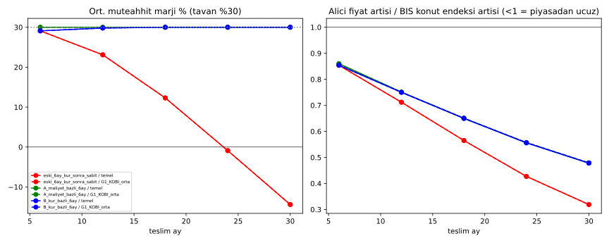

# 6 Aylık Fiyat Güncelleme Kuralı — Backtest

Kod: [`endeks_6ay.py`](endeks_6ay.py) · Veri: [`data/ozet_endeks_6ay.csv`](data/ozet_endeks_6ay.csv), [`data/backtest_endeks_6ay.csv`](data/backtest_endeks_6ay.csv)

## Kural (README 9.3)
Fiyat 6 ayda bir güncellenir; %30 marj tavanı korunur (fiyat ≤ 1,30 × gerçekleşen maliyet).
- **Eski kural:** İlk 6 ay kura endeksli, sonra TL sabit (karşılaştırma için).
- **A — maliyet bazlı:** Sözleşme fiyatı, son 6 aylık güncelleme noktasındaki grup bazlı maliyet endeksiyle (G1 TÜİK malzeme, G2 USD/TRY, G3 %50/%50, işçilik TÜİK işçilik) çarpılır.
- **B — kur bazlı:** Sözleşme fiyatı, son 6 aylık güncelleme noktasındaki USD/TRY değişimiyle çarpılır.

**Varsayımlar:**
- Grup ağırlıkları [GIRDI_GRUPLARI.md](GIRDI_GRUPLARI.md) ile aynı: işçilik %35; girdi içinde G1 %70, G2 %10, G3 %20.
- Maliyet inşaat süresine eşit dağılır.
- Alıcı teslimde öder.
- Kohortlar 2019-12 → 2025-12.
- **G1 KOBİ orta senaryo:** G1 fiyat çarpanı = (1−0,179)/0,9 × 0,95 = 0,867 (Çimsa 2025 FAVÖK %17,9 + %5 ölçek düşüşü; varsayım).
- **Piyasa karşılaştırması:** Alıcı fiyatındaki artış / BIS Türkiye nominal konut fiyat endeksi (FRED QTRN628BIS) artışı. Değer <1 ise platform fiyatı piyasadan yavaş artmış demektir.

## Sonuçlar — temel senaryo

| Kural | Teslim | Kohort | Ort. marj | Min. marj | Zarar eden | Tavan aşımı (tavan devrede) | Tavansız ham marj ort. | Alıcı fiyat artışı / BIS |
|---|---|---|---|---|---|---|---|---|
| Eski | 6 | 67 | %29,1 | %20,6 | 0 | 56 | %42,2 | 0,85 |
| Eski | 12 | 61 | %23,1 | %4,1 | 0 | 21 | %27,5 | 0,71 |
| Eski | 18 | 55 | %12,3 | −%10,7 | 12 | 6 | %13,0 | 0,57 |
| Eski | 24 | 49 | −%0,9 | −%21,3 | 24 | 0 | −%0,9 | 0,43 |
| Eski | 30 | 43 | −%14,4 | −%29,8 | 37 | 0 | −%14,4 | 0,32 |
| A maliyet | 6 | 67 | %30,0 | %30,0 | 0 | 67 | %46,0 | 0,86 |
| A maliyet | 12 | 61 | %30,0 | %30,0 | 0 | 61 | %62,4 | 0,75 |
| A maliyet | 18 | 55 | %30,0 | %30,0 | 0 | 55 | %81,2 | 0,65 |
| A maliyet | 24 | 49 | %30,0 | %30,0 | 0 | 49 | %101,6 | 0,56 |
| A maliyet | 30 | 43 | %30,0 | %30,0 | 0 | 43 | %121,7 | 0,48 |
| B kur | 6 | 67 | %29,1 | %20,6 | 0 | 56 | %42,2 | 0,85 |
| B kur | 12 | 61 | %29,8 | %25,9 | 0 | 56 | %51,9 | 0,75 |
| B kur | 18 | 55 | %30,0 | %28,3 | 0 | 54 | %62,6 | 0,65 |
| B kur | 24 | 49 | %30,0 | %30,0 | 0 | 49 | %76,1 | 0,56 |
| B kur | 30 | 43 | %30,0 | %30,0 | 0 | 43 | %84,4 | 0,48 |

**G1 KOBİ orta senaryo:**
- Marj ve zarar sonuçları A ve B kurallarında aynıdır (zarar 0, marj ~%30), çünkü fiyat maliyete bağlı.
- Alıcı fiyatı, temel senaryoya göre **yaklaşık %6 daha düşük**. Örnek: A kuralı, 24 ay teslimde alıcı fiyatı başlangıç maliyetinin ortalama 1,98 katı (temel senaryoda 2,11 katı).
- Eski kuralda G1 KOBİ mekanizması 24 ay teslimde zararı önlemiyor (25/49).

## Okuma
1. **6 aylık güncelleme (A veya B) zararı tüm kohortlarda ortadan kaldırıyor.** Eski kural 24 ayda 49 kohorttan 24'ünü, 30 ayda 43 kohorttan 37'sini zarara sokuyordu.
2. **%30 tavan sürekli devrede.** Bir dönem için güncellenen fiyat, ortalama maliyetin önünde gidiyor; tavan olmasa ham marj %46–122'ye çıkardı. Sonuç olarak marj fiilen **%30'a kilitleniyor**: tavan, kuralın asıl sınırlayıcısı.
3. **Kur bazlı (B) ilk 12–18 ayda maliyet bazlıdan (A) biraz daha dalgalı** (min. marj %20,6–28,3). 2019–2025 döneminde kur artışı maliyet artışına yakın seyrettiği için uzun vadede sonuç benzer. Kur ile maliyetin ayrıştığı dönemlerde B'nin riski daha yüksek; A doğrudan maliyeti izliyor.
4. **Alıcı fiyatı piyasanın altında:** Platform fiyatı, BIS konut endeksindeki artışın 24 ay teslimde yaklaşık %56'sı, 30 ay teslimde yaklaşık %48'i kadar arttı. Model inşaat maliyeti bazlıdır; arsa ve piyasa primi dahil değildir.

## Sınırlar
- Ağırlıklar ve G1 KOBİ çarpanı varsayımdır.
- BIS endeksi tüm konut stokunu kapsar (arsa ve ikinci el dahil). Platform fiyatıyla doğrudan karşılaştırma yalnızca eğilim karşılaştırmasıdır.
- Finansman maliyeti ve tahsilat zamanlaması modelde yoktur.
