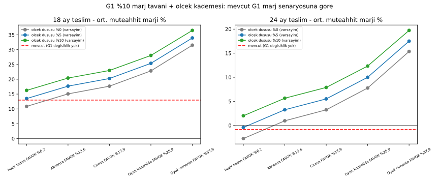

# G1 KOBİ Üretici Ağı ve %10 Marj Karşılık Mekanizması

Kod: [`g1_kobi.py`](g1_kobi.py) · Veri: [`data/g1_kobi_senaryolar.csv`](data/g1_kobi_senaryolar.csv) · Model metni: README Bölüm 7.1

> **Varsayım / yorum:** G1 üreticileri KOBİ ölçeğinde, platforma %10 kâr tavanıyla üretir. Karşılığında platform alım garantisi/talep havuzu, yatırım-kapasite desteği ve girdi maliyeti düşüşüne bağlı teşvik sağlar. Destek, ölçek artışı ve birim maliyet düşüşüyle eş zamanlı kademelenir.

## 1. Kaynaklı bulgular

### Pazar yoğunlaşması (çimento)
| Veri | Değer | Dönem | Kaynak |
|---|---|---|---|
| Klinker kapasitesi, ilk 10 grup | Oyak 12,6; Limak 10,3; Akçansa 7,0; Medcem 6,5; Aşkale 5,9; Çimsa 5,4; Çimko-Sanko 4,9; Çimentaş 4,2; Nuh 4,2; Batı 4,1; diğer 17 grup 33,1; toplam 98,3 Mt | 2024 sunumu | Oyak Çimento yatırımcı sunumu (Türk Çimento verisi) — https://assets.oyakcimento.com/contents/pdf/2025239/86831756388455320874.pdf |
| Hesaplanan pay | İlk 2 grup %23,3; ilk 10 grup %66,3 (yukarıdaki tablodan hesap) | 2024 | aynı |
| Tesis sayısı | 34 grup/üretici; 56 entegre, 22 öğütme-paketleme tesisi; klinker kapasitesi 100,99 Mt, çimento kapasitesi 149,33 Mt | 2024 | Oyak Çimento 2025 faaliyet raporu — https://assets.oyakcimento.com/contents/pdf/202657/87171772214181565685.pdf |
| Entegre tesis payı | Çimento üretiminin %94'ü entegre tesislerde; entegre tesis çimento kapasite kullanımı %59 | 2024 | ETKB Çimento Sektörü Kıyaslama Raporu 2024 |

Hazır beton ve seramik için yoğunlaşma (pazar payı) verisi **bulunamadı**.

### Sektör kâr marjları (borsa şirketleri, 2025)
| Şirket | Brüt kâr marjı | FAVÖK marjı | Kaynak |
|---|---|---|---|
| Oyak Çimento (konsolide) | %26,7 | %25,9 (şirket sunumu %26,3) | Gedik Yatırım 4Ç25 değerlendirmesi; Oyak finansal sonuç sunumu |
| Oyak — çimento faaliyetleri | — | **%37,9** | Oyak finansal sonuç sunumu 2025 |
| Oyak — hazır beton ve agrega | — | **%6,2** | aynı |
| Çimsa | %19,6 | %17,9 | Çimsa 2025 finansal sonuç bülteni |
| Akçansa | — (4Ç25: %16,4) | %13,6 | Akçansa 2025 sonuçları; Trdunya Capital |

Not: Rakamlar enflasyon muhasebesine (TMS 29) göre düzeltilmiştir. Seramik, tuğla/gazbeton için şirket marjı **bulunamadı**.

### Rekabet Kurulu kararları (hazır beton / çimento)
| Soruşturma | Karar | Ceza | Kaynak |
|---|---|---|---|
| Ankara-Kırıkkale hazır beton | 25.07.2024, 24-31/726-308 | Uzlaşmayla 5 firmaya 65,1 mn TL; ayrıca BİRLİK 6,1, LİMMER 14,5, OZAN 33,3, UĞURAL 29,9, ZİRVE 28,0, EFAŞ 2,0 mn TL (bölge/müşteri paylaşımı, fiyat tespiti, bilgi değişimi) | haber.rekabet.gov.tr |
| Adana-Osmaniye hazır beton | 25.07.2024, 24-31/727-309 | Oyak 61,2 mn TL ve Tiftik 5,2 mn TL (uzlaşma); Samet 6,6 mn TL | haber.rekabet.gov.tr |
| Hatay çimento/hazır beton | 13.03.2025, 25-10/231-116 | Uzlaşmalarla toplam 110,6 mn TL; Ceyhan 0,52 ve Filitoğlu 0,10 mn TL | rekabet.gov.tr PDF |
| Aydın hazır beton/çimento | 27.05.2025 duyurusu | 15 teşebbüse toplam ~190 mn TL (Çimentaş müşteri paylaşımına aracılık) | haber.rekabet.gov.tr |
| Malatya hazır beton/çimento/agrega | 02.06.2025 duyurusu | Toplam ~72 mn TL; fiyat tespiti, müşteri paylaşımı, işçi ücreti tespiti | haber.rekabet.gov.tr |

**Okuma:** Çimento aşamasında marj yüksek (Oyak çimento FAVÖK %37,9) ve kapasite birkaç grupta yoğun. Hazır betonda marj düşük (%6,2), ama yerel kartel kararları sık. Tekel rantı ağırlıkla klinker/çimento aşamasında ve yerel hazır beton pazarlarında görünüyor.

## 2. Simülasyon

**Yöntem:**
- G1 malzeme fiyatı, mevcut marj m₀'dan %10 marja iner ve ölçek kademesiyle birim maliyet s kadar düşer.
- G1 fiyat çarpanı = (1−m₀)/0,9 × (1−s).
- Diğer her şey [GIRDI_GRUPLARI.md](GIRDI_GRUPLARI.md) ile aynı:
  - G1 toplam maliyetin %45,5'i (varsayım).
  - Mevcut fiyat kuralı: ilk 6 ay kur endeksli, sonra TL sabit; %30 tavan.
  - Grup bazlı maliyet endeksleri.

**Varsayımlar:**
- FAVÖK marjı, fiyatlamadaki kâr payının yaklaşığı olarak kullanıldı. FAVÖK ≠ fiyatlama marjı, bu bir **varsayımdır**.
- m₀ tüm G1 sepetine uygulandı. Gerçekte çimento, demir, seramik vb. farklıdır, bu nedenle sonuçlar **aralık** olarak okunmalıdır.
- Ölçek düşüşü %0/%5/%10 **varsayımdır**.

| G1 mevcut marj senaryosu | Ölçek düşüşü | G1 fiyat çarpanı | Konut maliyeti değişimi | 18 ay ort. marj | 18 ay zarar | 24 ay ort. marj | 24 ay zarar |
|---|---|---|---|---|---|---|---|
| Mevcut (değişiklik yok) | — | 1,000 | 0 | %13,0 | 12/55 | −%0,9 | 24/49 |
| Hazır beton %6,2 | %0 | 1,042 | **+%1,9** | %10,9 | 14/55 | −%2,7 | 26/49 |
| Hazır beton %6,2 | %10 | 0,938 | −%2,8 | %16,3 | 7/55 | %2,0 | 23/49 |
| Akçansa %13,6 | %0 | 0,960 | −%1,8 | %15,1 | 7/55 | %1,0 | 23/49 |
| Akçansa %13,6 | %10 | 0,864 | −%6,2 | %20,4 | 6/55 | %5,7 | 20/49 |
| Çimsa %17,9 | %5 | 0,867 | −%6,1 | %20,3 | 6/55 | %5,5 | 20/49 |
| Oyak konsolide %25,9 | %0 | 0,823 | −%8,0 | %22,8 | 5/55 | %7,8 | 19/49 |
| Oyak konsolide %25,9 | %10 | 0,741 | −%11,8 | %28,0 | 0/55 | %12,3 | 14/49 |
| Oyak çimento %37,9 | %0 | 0,690 | −%14,1 | %31,5 | 0/55 | %15,4 | 10/49 |
| Oyak çimento %37,9 | %10 | 0,621 | −%17,2 | %36,5 | 0/55 | %19,7 | 6/49 |

Tüm satırlar CSV'dedir.

**Okuma:**
1. Mevcut marj %10'un altındaysa (hazır beton %6,2), %10 tavanı fiyatı **artırır**. Kazanç yalnızca ölçek kaynaklı maliyet düşüşünden gelir.
2. Orta senaryoda (Akçansa/Çimsa marjları, ölçek düşüşü %5), konut maliyeti yaklaşık %4–6 düşer. 24 ay teslimde zarar eden kohort 24/49'dan 20–23/49'a iner.
3. Yalnızca yüksek-rant senaryosunda (çimento %37,9) 18 ay teslimde zarar tamamen ortadan kalkar. 24 ay teslimde kur/enflasyon riski G1 mekanizmasıyla tek başına çözülmüyor: fiyat endeksleme kuralı (GIRDI_GRUPLARI.md §5) ayrıca kalibre edilmeli.

## 3. Eksikler (bulunamadı, uydurulmadı)
- Hazır beton, seramik, tuğla/gazbeton pazar payları ve HHI.
- Seramik ve tuğla/gazbeton şirketlerinin marjları.
- KOBİ ölçekli tesis ile entegre tesis arasındaki birim maliyet farkı (ölçek ekonomisi kaybının büyüklüğü).
- G1 sepetinin kalem bazlı maliyet payı.
- Rekabet Kurulu çimento (klinker) düzeyinde ulusal ölçekli güncel karar: yalnızca yerel/bölgesel kararlar bulundu.
