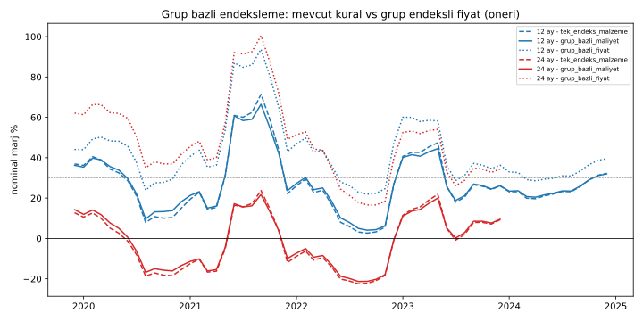

# Girdi Grupları — Ölçekli Yerli / İthal Makine-Teçhizat / Sınırlı Yerli Üretim

Kod: [`girdi_gruplari.py`](girdi_gruplari.py) · Veriler: [`data/girdi_gruplari.csv`](data/girdi_gruplari.csv), [`data/backtest_grup_bazli.csv`](data/backtest_grup_bazli.csv), [`data/ozet_grup_bazli.csv`](data/ozet_grup_bazli.csv)

Not: Sınıflandırma, aşağıdaki kaynaklı verilere ve bunlar bulunamayan kalemlerde genel sektör yapısına dayanan **ön değerlendirmedir**. "—" = kaynaklı veri bulunamadı.

## 1. Sınıflandırma ve kaynaklı veriler

### Grup 1 — Ölçekli üretilebilen (yerli kapasite iç talebi karşılıyor / ihracatçı)

| Kalem | Kaynaklı veri | Dönem | Kaynak | İthal girdi bağımlılığı / kur duyarlılığı |
|---|---|---|---|---|
| Çimento | Üretim ~93,7 Mt; iç satış ~77,9 Mt; ihracat ~15 Mt; kapasite ~125 Mt | 2025 | TÜRKÇİMENTO (V. Bozay, businessworldglobal.com); capital.com.tr | Enerji (ithal yakıt) üzerinden dolaylı — sayısal pay bulunamadı |
| Hazır beton | — (çimento + agrega; yerel üretim) | — | — | Çimento ile aynı |
| İnşaat demiri | Ham çelik 38,1 Mt; uzun ürün ihracatı 8,06 Mt, bunun %50,6'sı inşaat çeliği | 2025 | TÇÜD Aralık 2025 bülteni; ÇİB 2026 kataloğu | **Yüksek:** ham çeliğin %86,8'i hurdaya dayalı; hurda ithalatı 18,77 Mt (dünyanın en büyük ithalatçısı) → dolar fiyatlı hurda (BIR raporu, steelorbis; steelradar/TÇÜD) |
| Seramik karo / vitrifiye | Kaplama kapasitesi 600 milyon m² (SERKAP) / 690 milyon m² (SERFED notu); üretim 2023: 472 milyon m²; ihracat 2024: 96 milyon m²; ihracatta yerli katma değer %81 (kaplama), %82 (sağlık gereçleri) | 2021–2024 | Türkiye Seramik Federasyonu / SERKAP | Düşük-orta (yerli katma değer ~%81) |
| Tuğla / gazbeton | — | — | — | — |
| Cam (düz cam) | Fasıl 70 (cam ve cam eşya) ihracat 1.549 mn $, ithalat 1.409 mn $ | 2025 | TÜİK dış ticaret (KOTO raporu aktarımı) | Fasıl tüm cam eşyayı kapsar; düz cama özgü veri bulunamadı |
| Boya | — | — | — | — |
| Kablo | — | — | — | Bakır (LME, dolar) — sayısal pay bulunamadı |

### Grup 2 — İthal makine-teçhizat

| Kalem | Kaynaklı veri | Dönem | Kaynak |
|---|---|---|---|
| İnşaat ve madencilik makineleri (toplam) | İthalat 1,767 milyar $ (ilk 8 ay); ihracat 1,261 milyar $ (ilk 8 ay); 2024 ihracat 2,14 milyar $ | 2025 | İMDER (yatirimlar.com röportajı) |
| Beton pompası | İthalat 72 mn $ (507 adet; Çin 32,1, G. Kore 17,1, Almanya 13,1, İtalya 9,1 mn $); ihracat 78 mn $ (825 adet) | 2023 | IndexBox (ticari veri derlemesi) |
| Kule vinç / kalıp sistemleri | — (alt kalem ayrımı bulunamadı) | — | — |
| İstif makineleri | İthalat 975 mn $, ihracat 358 mn $ (ilk 6 ay) | 2025 | İSDER (yapiinsaatdergisi.com) |
| Genel makine | Yıllıklandırılmış makine ithalatı 45,6 milyar $; ihracat/ithalat karşılama %62,6; Çin payı %27,8 | Kasım 2025 | MAİB/TİM (KUTSO raporu aktarımı) |

Not: Beton pompası örneğinde Türkiye hem ithalatçı hem ihracatçı; grup 2 "tamamen ithal" değil, **net ithalatçı ve dolar fiyatlı** olarak tanımlanmalı.

### Grup 3 — Sınırlı yerli üretim (ithal ama yerliliği olan)

| Kalem | Kaynaklı veri | Dönem | Kaynak |
|---|---|---|---|
| PVC doğrama (PVC reçine) | Tek yerli üretici Petkim, kapasite 150 bin t/yıl; 2023 PVC ithalatı 936 bin t; hammaddede dışa bağımlılık ~%85 (2020); Petkim iç ihtiyacın ~%7'sini karşılıyor; 2025'te Petkim PVC üretimi ithal VCM'ye bağlı, 13 kesinti | 2020–2025 | PAGEV (ekonomim.com); SIBUR/ChemOrbis; EGEPLASDER (tekreferans.com); Petkim 2025 Faaliyet Raporu (Erzincan PVC raporu aktarımı) |
| Isı pompası | Ev tipi havadan suya ısı pompası ithalatı son 5 yılda %570, iç satış %265 arttı; 2023'te ithalat ve iç satış %45+ arttı | 2019–2023 | İSKİD |
| Asansör | İhracat 334 mn $ (dünya 9.); sektör "ithalat ağırlıklıdan ihracat potansiyeli yüksek yapıya" geçmiş; 2.068 firma | 2024 | AYSAD Asansör Sektörü Raporu 2024 |
| Alüminyum doğrama | — | — | — |
| Yalıtım (EPS/XPS/taşyünü) | EPS, yerli plastik hammadde üretiminin %15'i (toplam ~2,6 Mt) | 2025 (tahmin) | PAGEV 2025 (Erzincan raporu aktarımı) |
| Tesisat boruları (PVC/PP/PE) | Polimer ithalatı ~6 Mt (2024), 7 milyar $ | 2024 | ChemOrbis |
| Kombi | — | — | — |
| Elektronik / otomasyon | — | — | — |

## 2. Ana bulgular

1. **Grup 1'de kapasite var:** Çimento (kapasite ~125 Mt, üretim ~93,7 Mt), seramik (kapasite 600–690 milyon m², üretim 2023'te 472 milyon m²) iç talebin üzerinde; yerli girdi şartı bu kalemlerde uygulanabilir.
2. **İnşaat demiri "yerli ama dolar bağımlı":** Üretim yerli ancak hammaddesi büyük ölçüde ithal hurda (18,77 Mt). Grup 1'de olsa da fiyatı kura duyarlı → grup 1 içinde ayrı alt endeks (çelik) önerilir.
3. **PVC, grup 3'ün en net örneği:** Mamul (profil, boru) yerli ve ihracatçı, hammadde %85+ ithal; arz şoklarında (2021, 2025) hızlı fiyat artışı raporlanmış.
4. **Grup 2 net ithalatçı:** İnşaat makinelerinde ithalat ihracatı aşıyor; makine genelinde karşılama oranı %62,6.

## 3. Konut maliyetinde grup payları — **VARSAYIM**

Kaynaklı bir kalem bazlı maliyet kırılımı (Bakanlık birim maliyet analizleri, TÜİK İME ağırlıkları) **bulunamadı**. Simülasyonda aşağıdaki ağırlıklar açıkça varsayım olarak kullanıldı:

| | Pay (toplam maliyet içinde) | Gerekçe |
|---|---|---|
| İşçilik | %35 | Önceki simülasyonla aynı varsayım |
| Grup 1 (ölçekli yerli) | %45,5 (girdinin %70'i) | Kaba yapı (beton, demir, duvar, seramik) ağırlığı — varsayım |
| Grup 2 (ithal makine-teçhizat, kira/amortisman) | %6,5 (girdinin %10'u) | Varsayım |
| Grup 3 (sınırlı yerli) | %13 (girdinin %20'si) | Doğrama, tesisat, asansör, ısıtma, yalıtım — varsayım |

## 4. Modele önerilen ele alınış

| Grup | Yerli girdi şartı | Eşik / endeks | Araç |
|---|---|---|---|
| 1 — Ölçekli yerli | Tam uygulanır | TL bazlı, TÜİK İME malzeme endeksi (demir için ayrı çelik alt endeksi) | Onaylı tedarikçi sicili, toplu/çerçeve alım |
| 2 — İthal makine-teçhizat | Uygulanmaz (yerli muadil varsa puan) | Dolar endeksli | Platform kiralama havuzu, ortak kullanım, ithalat/yatırım teşviki, yerli üretici varsa öncelik |
| 3 — Sınırlı yerli | Kademeli (düşük oranla başlayıp yükselen) + geçici istisna | Karışık endeks (örn. %50 malzeme endeksi + %50 kur — varsayım) | Yerlileştirme yol haritası, hammadde kapasite yatırımı (ör. PVC/VCM) |

## 5. Simülasyon — grup bazlı endeksleme

Kohortlar 2019-12 → 2025-12; aylık değerler TÜİK İME Aralık noktaları arasında geometrik enterpolasyon. Grup 1 = TÜİK malzeme endeksi, Grup 2 = USD/TRY, Grup 3 = %50/%50 karışım, işçilik = TÜİK işçilik endeksi.

Modeller: **tek_endeks_kur** (ilk simülasyon varsayımı), **tek_endeks_malzeme** (GIRDI_VERILERI.md), **grup_bazli_maliyet** (mevcut fiyat kuralı, maliyet grup bazlı), **grup_bazli_fiyat** (**öneri**: 6. ayda kilitlenen fiyatın yarısı teslime kadar grup bazlı maliyet endeksine bağlı).

| Teslim | Model | Kohort | Ort. nominal marj | En düşük | Zarar eden |
|---|---|---|---|---|---|
| 12 ay | tek_endeks_kur | 61 | %29,1 | %8,6 | 0 |
| 12 ay | grup_bazli_maliyet | 61 | %27,5 | %4,1 | 0 |
| 12 ay | grup_bazli_fiyat (öneri) | 61 | %42,7 | %21,9 | 0 |
| 18 ay | tek_endeks_kur | 55 | %15,8 | −%6,7 | 6 |
| 18 ay | grup_bazli_maliyet | 55 | %13,0 | −%10,7 | 12 |
| 18 ay | grup_bazli_fiyat (öneri) | 55 | %44,6 | %18,9 | 0 |
| 24 ay | tek_endeks_kur | 49 | %2,6 | −%17,3 | 22 |
| 24 ay | grup_bazli_maliyet | 49 | −%0,9 | −%21,3 | 24 |
| 24 ay | grup_bazli_fiyat (öneri) | 49 | %48,3 | %16,6 | 0 |

**Okuma:**
- Maliyet tarafını grup bazlı hesaplamak sonucu çok değiştirmiyor: mevcut fiyat kuralıyla 24 ay teslimde 49 kohortun 24'ü zararda.
- **Kısmi grup endeksli fiyat** zararı tamamen ortadan kaldırıyor, ancak ortalama marjı %30 tavanının belirgin üzerine çıkarıyor (%42–48). Neden: ilk 6 ay kur endekslemesi zaten maliyetin önünde gidiyor. Öneri, **endeksleme oranı ve 6 aylık kur endekslemesinin birlikte kalibre edilmesi** gerektiğini gösteriyor (örn. ilk 6 ayda da grup endeksi kullanmak veya kısmi oranı düşürmek). Bu kalibrasyon yapılmadı.

## 6. Bulunamayanlar (uydurulmadı)

- Kalem bazlı konut maliyet kırılımı (Bakanlık birim fiyat analizleri, TÜİK İME madde ağırlıkları).
- Tuğla/gazbeton, boya, kablo, alüminyum doğrama, kombi, elektronik/otomasyon için üretim/kapasite/dış ticaret verisi.
- Kule vinç ve kalıp sistemleri için ayrı ithalat verisi.
- Yİ-ÜFE alt kalemleri (çimento, inşaat demiri, hazır beton) ile kalem bazlı kur duyarlılığı.
- Çimentoda enerji kaynaklı ithal girdi payı.
