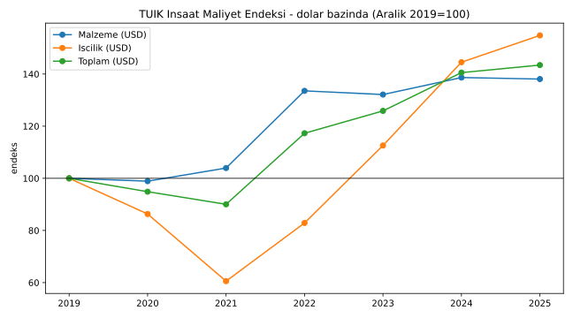
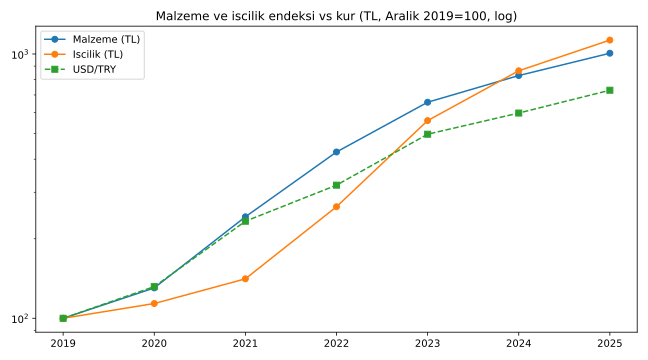
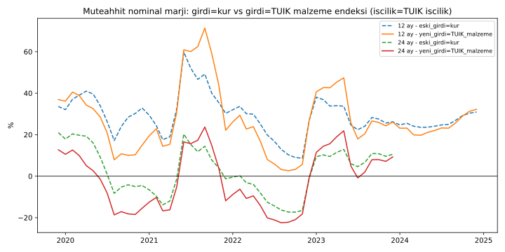

# Girdi Maliyetleri — Gerçek Veriler Ne Diyor?

Kod: [`girdi_analizi.py`](girdi_analizi.py) · Veriler: [`data/ime_aralik_yillik_degisim.csv`](data/ime_aralik_yillik_degisim.csv), [`data/girdi_endeks_aralik2019_100.csv`](data/girdi_endeks_aralik2019_100.csv), [`data/backtest_gercek_girdi.csv`](data/backtest_gercek_girdi.csv), [`data/ozet_gercek_girdi.csv`](data/ozet_gercek_girdi.csv)

## 1. TÜİK İnşaat Maliyet Endeksi — malzeme ve işçilik (yıllık değişim, Aralık ayları)

Kaynak: TÜİK İnşaat Maliyet Endeksi haber bültenleri (2015=100), bülten metinlerini aktaran haber kaynakları üzerinden. Değerler "bir önceki yılın aynı ayına göre" değişimdir.

| Dönem | Toplam | Malzeme | İşçilik | Kaynak (bülteni aktaran) |
|---|---|---|---|---|
| Aralık 2020 | %25,02 | %30,34 | %13,74 | uzmanpara.milliyet.com.tr |
| Aralık 2021 | %67,74 | %85,77 | %24,01 | haberturk.com, trthaber.com |
| Aralık 2022 | %78,40 | %75,93 | %87,41 | ekonomidunya.com (10.02.2023) |
| Aralık 2023 | %67,31 | %54,26 | %111,83 | aa.com.tr |
| Aralık 2024 | %34,27 | %26,18 | %54,35 | aa.com.tr (12.02.2025) |
| Aralık 2025 | %24,50 | %21,47 | %30,67 | aa.com.tr |
| Ekim 2025 | %22,57 | %18,68 | %30,49 | timder.org.tr |
| Ağustos 2026 (son bülten) | %29,59 | %28,72 | %31,20 | aa/ankahaber.net, cnbce.com |

**Doğrulama:** Yıllık değişimler zincirlenerek elde edilen toplam endeks, hakedis.org'un TÜİK'ten aktardığı toplam endeks seviyeleriyle (Aralık 2019 = 192,25 → Aralık 2025 = 2.011,76) birebir örtüşüyor (Aralık 2019=100 bazında 1.046,4).

## 2. Endeks seviyeleri (Aralık 2019 = 100) — TL ve dolar bazında

Dolar bazı: endeks / USD/TRY (Aralık ayı ortalaması, ECB referans kuru — Frankfurter API).

| Aralık | Malzeme TL | İşçilik TL | USD/TRY | Malzeme USD | İşçilik USD | Toplam USD |
|---|---|---|---|---|---|---|
| 2019 | 100 | 100 | 5,9 | 100 | 100 | 100 |
| 2020 | 130,3 | 113,7 | 7,7 | 98,9 | 86,3 | 94,9 |
| 2021 | 242,1 | 141,0 | 13,6 | 103,9 | 60,6 | 90,0 |
| 2022 | 426,0 | 264,3 | 18,7 | 133,5 | 82,9 | 117,3 |
| 2023 | 657,1 | 560,0 | 29,1 | 132,1 | 112,6 | 125,9 |
| 2024 | 829,2 | 864,3 | 35,0 | 138,7 | 144,5 | 140,5 |
| 2025 | 1.007,2 | 1.129,4 | 42,7 | 138,1 | 154,8 | 143,4 |

## 3. Bulgular

1. **Malzeme kurla birebir gitmiyor; kurdan hızlı arttı.** Aralık 2019 → Aralık 2025 malzeme endeksi TL'de ~10,1 kat, USD/TRY ~7,2 kat arttı. Yani malzeme maliyeti **dolar bazında ~%38 arttı** (endeks 138,1).
2. **Kopuş 2022'de:** 2020–2021'de dolar bazlı malzeme yaklaşık sabitken (98,9 → 103,9), 2022'de 133,5'e sıçradı ve sonra o seviyede kaldı.
3. **İşçilik en dalgalı kalem:** Dolar bazında 2021'de 60,6'ya düştü, 2025'te 154,8'e çıktı. 2023–2024'te işçilik yıllık artışı malzemenin iki katı civarında (%111,83 ve %54,35).
4. **Son dönem:** Ağustos 2026 itibarıyla malzeme yıllık %28,72, işçilik %31,20.

## 4. Simülasyon yeniden çalıştırıldı: "girdi = kur" yerine "girdi = TÜİK malzeme endeksi"

Yöntem: Aralık noktaları arasında aylık geometrik enterpolasyon (**varsayım** — aylık resmi seri indirilemedi). İşçilik her iki modelde de TÜİK işçilik endeksi. Diğer varsayımlar [SIMULASYON.md](SIMULASYON.md) ile aynı (%65 girdi / %35 işçilik, 100.000 $ maliyet, %30 tavan, 6 ay endeks). Kohortlar 2019-12 → 2025-12.

| Teslim | Model | Kohort | Ort. nominal marj | En düşük | Zarar eden kohort |
|---|---|---|---|---|---|
| 6 ay | girdi = kur | 67 | %42,7 | %21,4 | 0 |
| 6 ay | girdi = TÜİK malzeme | 67 | %42,1 | %19,1 | 0 |
| 12 ay | girdi = kur | 61 | %29,1 | %8,6 | 0 |
| 12 ay | girdi = TÜİK malzeme | 61 | %27,2 | %2,6 | 0 |
| 18 ay | girdi = kur | 55 | %15,8 | −%6,7 | 6 |
| 18 ay | girdi = TÜİK malzeme | 55 | %12,4 | −%11,8 | 14 |
| 24 ay | girdi = kur | 49 | %2,6 | −%17,3 | 22 |
| 24 ay | girdi = TÜİK malzeme | 49 | −%1,6 | −%22,5 | 26 |

**Sonuç:** Gerçek malzeme endeksi kullanıldığında tablo **daha kötü**: 18 ay teslimde zarar eden kohort 6'dan 14'e, 24 ayda 22'den 26'ya çıkıyor; 24 ay teslimde ortalama marj negatife dönüyor. "Girdi = kur" varsayımı müteahhidin riskini **olduğundan az** gösteriyordu. (Bu tablodaki "girdi = kur" satırları işçilik için TÜFE yerine TÜİK işçilik endeksi kullandığından SIMULASYON.md'deki sayılardan biraz farklıdır.)

## 5. Yerli üretim kapasitesi ve dış ticaret (bulunabilen)

- **Çimento (2025):** Üretim ~93,7 milyon ton, iç satış ~77,9 milyon ton, ihracat ~15 milyon ton (TÜRKÇİMENTO Başkanı Volkan Bozay açıklaması, businessworldglobal.com). Kapasite ~125 milyon ton olarak aktarılıyor (aynı kaynak / capital.com.tr) → kabaca %75 kapasite kullanımı (hesaplama).
- **İnşaat malzemesi sanayi ihracatı (2025):** 32,1 milyar $, Türkiye toplam ihracatının ~%12'si (Türkiye İMSAD).
- **Risk notu:** TÜRKÇİMENTO, AB Sınırda Karbon Düzenleme Mekanizması'nın (SKDM/CBAM) çimento ihracatını etkileyebileceği uyarısında bulunuyor (chemexworld.com).
- Bu veriler, çimento gibi temel kalemlerde **yerli kapasitenin iç talebi aştığını** gösteriyor; yerli girdi şartı en azından bu kalemlerde kapasite açısından uygulanabilir görünüyor.

## 6. Bulunamayanlar (uydurulmadı)

- TÜİK aylık İME serisinin (malzeme/işçilik endeks seviyeleri) doğrudan indirilebilir dosyası — veri portalından otomatik çekilemedi; yıllık değişimlerden zincirlendi.
- Yİ-ÜFE alt kalemleri (çimento, inşaat demiri, hazır beton) — çekilmedi.
- Bakanlık yapı yaklaşık birim maliyetleri tebliğleri (TL/m²) — çekilmedi.
- İnşaat girdilerinde ithal girdi payı (girdi-çıktı tabloları) — bulunamadı.
- İnşaat malzemesi toplam ithalat / dış ticaret dengesi (2025 yıllık) — net rakam bulunamadı.

## 7. Platform modeli için çıkarımlar

- Girdi maliyeti eşiği **dolar bazında sabit** tanımlanırsa yetersiz kalır: malzeme 2019–2025 arasında dolar bazında ~%38 pahalandı. Eşik TÜİK malzeme endeksine bağlı güncellenmeli.
- 6 ay sonra TL'de tam sabitleme, gerçek maliyet verisiyle daha da sürdürülemez; kısmi endeksleme (TÜİK İME malzeme + işçilik) önerisi güçlenir.
- İşçilik, eşik dışı tutulsa da dolar bazında en hızlı artan kalem; marj hesaplarında ayrı endekslenmeli.
