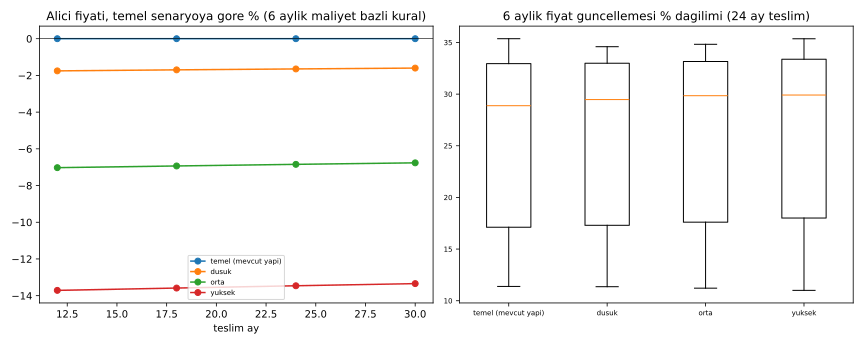

# Ölçek Modeline Yerlileştirilen Kalemler: Yerlilik Oranı, Maliyet ve Standardizasyon

Kod: [`olcek_yerlilestirme.py`](olcek_yerlilestirme.py)

Veriler (`data/` klasöründe):
- [`ozet_olcek_yerlilestirme.csv`](data/ozet_olcek_yerlilestirme.csv)
- [`oynaklik_6ay_guncelleme.csv`](data/oynaklik_6ay_guncelleme.csv)
- [`statik_maliyet_dususu.csv`](data/statik_maliyet_dususu.csv)
- [`yerlilik_orani.csv`](data/yerlilik_orani.csv)
- [`backtest_olcek_yerlilestirme.csv`](data/backtest_olcek_yerlilestirme.csv)

**Karar:** [YERLILESTIRME_2YIL.md](YERLILESTIRME_2YIL.md)'de "mümkün" (kombi, asansör, kule vinç, beton pompası) ve "kısmen" (yalıtım, ısı pompası, kablo, iş makineleri) sınıfındaki kalemler, G2/G3'ten **"Y — yerlileştirilen"** kategorisine geçer. Bu kalemler G1 KOBİ/orta ölçek üretici ağına ve %10 marj mekanizmasına dahil edilir (README 6.2a, 7.1).

## 1. Kısmen kalemlerde 2 yılda ulaşılabilir yerlilik

| Kalem | Kaynaklı kırılım | Mevcut yerlilik | 2 yıl hedefi | Gerekçe |
|---|---|---|---|---|
| **Yalıtım (EPS/XPS)** | Polistiren: yerli 150 bin t / tüketim 320 bin t = **%47** (2024, DİOKİ CEO, Ekonomim) | **~%58–79 (varsayım)**. Hammaddenin ürün maliyetindeki payı %40–80 varsayıldı (kaynak bulunamadı); işleme yerli. Formül: (1−h) + h×0,47 | **~%58–79 (değişmez)** | Açıklanmış polistiren kapasite artışı bulunamadı; hammadde yerliliği %47'de kalır |
| **Isı pompası** | Kompresör, elektronik genleşme valfi, kontrol, soğutucu gaz "büyük ölçüde ithal" (IndexBox); Form CEO: saç, bakır boru, kompresör, otomasyon ithal (Dünya, 2025). Yüzde pay bulunamadı | **%40–60 (varsayım)** | **%55–70 (varsayım)** | Gövde, eşanjör, montaj ve hidronik yerlileşebilir. Yerli kompresör üretimine dair kanıt bulunamadı, bu yüzden kompresör payı (varsayım %15–25) 2 yılda ithal kalır |
| **Kablo** | Metal bakır üretimi 170 bin t / tüketim 450 bin t = **%38** (2023, Eti Bakır, Hürriyet). Eti Bakır katot kapasitesi 90 bin t, üretim ~70 bin t | **~%50–66 (varsayım)**. Bakırın kablo maliyetindeki payı %55–80 varsayıldı (kaynak bulunamadı). Formül: (1−c) + c×0,38 | **~%52–68 (varsayım)** | Eti Bakır kapasitesinin tam kullanımı (+20 bin t) bakır yerliliğini 190/450 = %42'ye çıkarır. Yeni izabe yatırımı bulunamadı |
| **İş makineleri** | Yerli girdi oranı ortalama **%55**, beton makineleri ve kırma-eleme alt sektörlerinde **%55–75** (İMDER sektör raporu 2024). Ankara analizi **%61,5** (Ankara iş makineleri sektör analizi). Dizel motor tamamen ithal; 250 kW ekskavatörde motor ~20 bin $ / makine ~180 bin $ ≈ **%11** (Ankara dizel motor ön fizibilitesi 2020) | **%55–61,5 (kaynaklı)** | **%65–75 (varsayım; üst sınır kaynaklı alt sektör bandı)** | Motor (~%11) 2 yılda ithal kalır; mutlak üst sınır yaklaşık %89 |
| Kombi, asansör, kule vinç, beton pompası ("mümkün") | Bileşen kırılımı bulunamadı | **%60–80 (varsayım)** | **%70–85 (varsayım)** | Nihai ürün zaten yerli üretiliyor |

**Simülasyonda kullanılan Y kategorisi ortalama yerlilik (varsayım):** düşük %55, orta %65, yüksek %75.

## 2. Maliyet modeli varsayımları

| Parametre | Değer | Etiket |
|---|---|---|
| İşçilik / girdi | %35 / %65 | Varsayım (önceki simülasyonlar) |
| Girdi içinde G1 / G2 / G3 | %70 / %10 / %20 | Varsayım |
| Y'ye geçen pay | G2'nin %60'ı + G3'ün %50'si = girdinin %16'sı | Varsayım. G3'te kalan: PVC, alüminyum, otomasyon |
| Y endeksi | yerlilik × TÜİK malzeme + (1 − yerlilik) × USD/TRY | Model kuralı |
| G1 fiyat çarpanı | (1 − mevcut marj)/0,9 × (1 − ölçek) | Marjlar kaynaklı (2025 FAVÖK); ölçek varsayım |
| Y fiyat çarpanı | aynı formül; mevcut marj %15/%20 | **Varsayım (Y kalemleri için sektör marjı bulunamadı)** |
| Fiyat kuralı | 6 ayda bir maliyet bazlı güncelleme, %30 tavan (README 9.3) | Model kuralı |

| Senaryo | G1 mevcut marj | G1 ölçek | Y yerlilik | Y mevcut marj | Y ölçek |
|---|---|---|---|---|---|
| Düşük | %13,6 (Akçansa) | %0 | %55 | değişmez | %0 |
| Orta | %17,9 (Çimsa) | %5 | %65 | %15 | %5 |
| Yüksek | %25,9 (Oyak konsolide) | %10 | %75 | %20 | %10 |

## 3. Sonuçlar

### Maliyet düşüşü ve kur duyarlılığı

| Senaryo | Konut birim maliyeti (t₀, statik) | Alıcı fiyatı, temele göre (24 ay, backtest) | Kura bağlı maliyet payı |
|---|---|---|---|
| Temel (mevcut yapı) | 0 | 0 | %13,0 |
| Düşük | **−%1,8** | −%1,6 | %10,5 |
| Orta | **−%7,1** | −%6,9 | %9,5 |
| Yüksek | **−%13,9** | −%13,5 | %8,5 |

Tüm senaryolarda müteahhit marjı %30, min. marj %30 ve zarar eden kohort 0'dır (12/18/24/30 ay teslim). Bunu 6 aylık maliyet bazlı kural sağlar; marj tavana kilitlidir (bkz. ENDEKS_6AY.md).

### Standardizasyon: fiyat oynaklığı ve kohort yayılımı (24 ay teslim)

| Senaryo | 6 aylık güncelleme ort. | Std. sapma | P10–P90 | Kohortlar arası fiyat çarpanı CV |
|---|---|---|---|---|
| Temel | %25,9 | 7,96 puan | %13,3–34,3 | 0,100 |
| Düşük | %26,0 | 7,88 puan | %13,4–34,1 | 0,100 |
| Orta | %26,1 | 7,89 puan | %13,5–34,1 | 0,101 |
| Yüksek | %26,2 | 7,95 puan | %13,5–34,2 | 0,103 |

## 4. Okuma

1. **Maliyet düşer:** Orta senaryoda konut birim maliyeti yaklaşık %7, yüksek senaryoda yaklaşık %14 düşer. Kazancın çoğu G1'in %10 marja inmesinden ve ölçekten gelir; Y kalemlerinin katkısı küçüktür (girdinin %16'sı).
2. **Kur duyarlılığı azalır:** Kura bağlı maliyet payı %13'ten %8,5–10,5'e iner.
3. **Fiyat oynaklığı 2019–2025 verisinde azalmıyor (bulgu):** Endeks değişiminden kaynaklı oynaklık neredeyse aynı kalıyor (std. ~7,9 puan, CV ~0,10). Nedeni, bu dönemde TÜİK malzeme endeksinin USD/TRY'ye yakın hızda artmış olması: dolar bazında malzeme Aralık 2019 = 100 → Aralık 2025 = 138 (GIRDI_VERILERI.md). Kur endeksinden malzeme endeksine geçmek oynaklığı ancak iki endeks ayrıştığında düşürür.
4. **Standardizasyon fiyat seviyesinde ve kuralda görünüyor, oynaklıkta değil:**
   - Seviye: aynı ürün için katalog fiyatı ve %10 marj tavanı, ve %1,6–13,5 daha düşük alıcı fiyatı.
   - Kural: 6 aylık öngörülebilir güncelleme ve sıfır zarar.
   - Fiyat oynaklığını azaltmak için ek araç gerekir: G1 malzeme endeksinin kendisini düşürecek arz artışı veya fiyat bandı (simüle edilmedi).

## 5. Eksikler (uydurulmadı)
- Ürün maliyetinde hammadde/bileşen payları: polistiren/yalıtım, kompresör/ısı pompası, bakır/kablo. Varsayım aralığı kullanıldı.
- Kombi, asansör, beton pompası güncel yerlilik oranları.
- Y kalemleri için sektör kâr marjları.
- Y kalemlerinin konut maliyetindeki payı (girdinin %16'sı varsayımdır).
- Polistiren ve bakır için açıklanmış yeni kapasite yatırımları.
- Yerli kompresör üretimi kanıtı.
