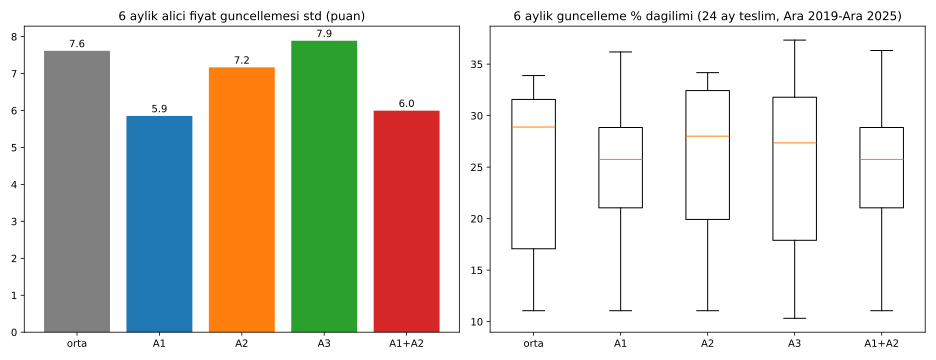

# Oynaklık Yönetimi Araçları: Uluslararası Örnekler ve Backtest

Kod: [`oynaklik_araclari.py`](oynaklik_araclari.py). Veri:
- [`data/oynaklik_araclari_ozet.csv`](data/oynaklik_araclari_ozet.csv) (δ=±5 puan)
- [`data/oynaklik_araclari_ozet_delta10.csv`](data/oynaklik_araclari_ozet_delta10.csv) (δ=±10 puan)
- [`data/oynaklik_araclari_backtest.csv`](data/oynaklik_araclari_backtest.csv) (δ=±5 puan)

**Çıkış noktası:** Yerlileştirme fiyat seviyesini düşürüyor, ancak 6 aylık güncellemenin oynaklığını düşürmüyor (std ≈ 7,6–8,0 puan; ortalama ≈ %26). Bkz. [OLCEK_YERLILESTIRME.md](OLCEK_YERLILESTIRME.md).

Aşağıda oynaklığı hedefleyen araçlar araştırıldı.

## 1. Uluslararası yöntemler (kaynaklı)

**Kanıt durumu:** Bulunan kaynakların hiçbiri, aracın fiyat oynaklığını ölçülmüş biçimde düşürdüğünü göstermiyor. "Kanıt" sütunu yalnızca kaynağın söylediğini aktarır.

| # | Ülke | Mekanizma | Kurum, yıl | Kaynakta belirtilen etki | Sorunlar | Kaynak |
|---|---|---|---|---|---|---|
| 1 | Almanya | **Stoffpreisgleitklausel**: malzeme fiyat kayma maddesi. Teklifte verilen malzeme fiyatı, Destatis fiyat endeksiyle (Fachserie 17 Reihe 2) güncellenir. Artış ve düşüş birlikte uygulanır. Bagatell sınırı %2, yüklenici katılımı %10 (Formblatt 225a). 2022'de çelik, alüminyum, bakır, petrol ürünleri, çimento ürünleri ve ahşap için genişletildi | BMWSB Erlass, 25.03.2022; 30.06.2023'te sona erdi | Sözleşme riskini paylaştırır. Oynaklığa etkisi ölçülmemiş | İdari yük (5.000 € alt sınırı getirildi). Geçici bir düzenleme | [Erlass](https://www.ing-rlp.de/files/ing-rlp/downloads/BMWSB_Stoffpreisgleitklausel_Erlass_2022_03_25.pdf), [LBB Bayern](https://www.lbb-bayern.de/fileadmin/news/20220622-Hinweise-zum-Formblatt-225a.pdf), [cosinex](https://blog.cosinex.de/2023/06/26/umgang-mit-preissteigerungen-im-baubereich-praxishinweise-des-bundes/) |
| 2 | ABD | **Fiyat ayarlama maddeleri (PAC)**: çelik, yakıt, asfalt, çimento. Manipüle edilemeyen endeks kullanılır; tetik %3–10 (genelde %5); hesap aylık; çift yönlü uygulanır | FHWA TA 5080.3 (1980); politika notu 2004; eyalet DOT'ları | FHWA: risk payını devreder ve "daha düşük teklif" sağlar. NCHRP 20-07(274) anketi: yükleniciler PAC yoksa ihtiyat payı eklediğini (%91), PAC varsa teklifin düşeceğini (%58) belirtiyor | Geriye dönük uygulanamaz. Proje bazlı uygulanmalı, kalıcı standart olmamalı | [FHWA TA 5080.3](https://www.fhwa.dot.gov/programadmin/contracts/ta50803.cfm), [2004 notu](https://www.fhwa.dot.gov/construction/contracts/040408.cfm), [NCHRP](https://onlinepubs.trb.org/onlinepubs/nchrp/docs/NCHRP20-07(274)_FR.pdf) |
| 3 | Hindistan | **CPWD 10CA / 10CC**: çimento ve çelik için V = P×Q×(I−I₀)/I₀. Diğer girdiler 10CC ile çeyreklik güncellenir; endeks, çeyreğin 3 aylık ortalamasıdır. Hesap tutarın %85'i üzerinden yapılır (%15 ayarlanmaz) | CPWD GCC 2008/2023 | Çeyreklik ortalama endeks ani sıçramayı yumuşatır. Etki ölçümü bulunamadı | Endeks gecikmesi | [10CC açıklama](https://nsrcivil.in/10cc-indices-for-civil-electrical/), [GCC metni](https://www.scribd.com/doc/169641718/CPWD-Clause-10) |
| 4 | Birleşik Krallık | **NEC4 X1**: fiyat ayarlama faktörü PAF = Σ pay×(L−B)/B. Ayarlanmayan pay ≤ %10 olarak önerilir | NEC / CECA Bülten 25, 2023 | Enflasyon riskini işverene taşır; teklifteki risk primini azaltma amacı | Endeks seçimi yüklenici maliyetiyle uyuşmazsa boşluk kalır | [NEC](https://www.neccontract.com/news/how-to-use-nec-secondary-option-x1-on-price-adjustment-for-inflation), [CECA](https://gmhplanning.co.uk/wp-content/uploads/2023/01/CECA-NEC4-Bulletin-No.25-Secondary-Option-X1-Price-Adjustment-For-Inflation-January-2023.pdf) |
| 5 | Güney Kore | **PPS tampon stoku** (alüminyum, bakır vb.): fiyatlar istikrarlıyken alım, fiyat yükselince KOBİ'lere öncelikli satış. İnovatif KOBİ'lere 3 kata kadar miktar | Kamu İhale Kurumu (PPS) | Kurum beyanı: arz kesintisinde stok yeterliliği korundu. Fiyata etkisi ölçülmemiş | Haftalık limit 40 t; stok maliyeti | [PPS](https://www.pps.go.kr/eng/content.do?key=01159), [korea.kr](https://www.korea.kr/news/policyNewsView.do?newsId=148963577) |
| 6 | Çin | **Devlet rezervi satışı**: bakır, alüminyum ve çinko. 2 partide 270 bin t (2021), üreticilere hedefli, KOBİ'ye öncelik veren açık artırmalarla | NDRC + Ulusal Tahıl ve Rezerv İdaresi, 2021 | NDRC: satışlar piyasa fiyatının altında gerçekleşti, "beklentiyi yönlendirdi". Bağımsız ölçüm yok | Büyük rezerv gerekir. Etki kısa süreli olabilir | [NDRC 2021-08](https://www.ndrc.gov.cn/xxgk/jd/jd/202108/t20210817_1293877.html), [gov.cn](https://english.www.gov.cn/statecouncil/ministries/202109/01/content_WS612f77d0c6d0df57f98df7dc.html) |
| 7 | Singapur | **Ulusal kum/granit stoku**, kaynak çeşitlendirme, ithalatçı lisansı; BCA aylık fiyat endeksi yayımlar | BCA / Kalkınma Bakanlığı | Bakan beyanı: stok ve çeşitlendirme arz kesintisini tamponladı. Fiyat etkisi ölçülmemiş | Ada ekonomisine özgü; agrega ile sınırlı | [Meclis yanıtı](https://telescope.gov.sg/transcript/25286), [BCA](https://www1.bca.gov.sg/safety-and-standards/applications-and-licenses/import-of-essential-construction-materials/) |
| 8 | Çin (piyasa) | **SHFE inşaat demiri vadeli işlemi**: hedge ve fiyat keşfi | SHFE | Akademik: vadeli fiyat spot fiyata öncülük ediyor, hedge için uygun | Baz riski. Türkiye'de inşaat demiri vadelisi bulunamadı | [Fiyat keşfi](https://ideas.repec.org/a/taf/apeclt/v26y2019i5p351-357.html), [baz riski](https://doi.org/10.4028/www.scientific.net/amr.655-657.2220) |
| 9 | İsveç | **Kombohus**: standart konut çerçeve anlaşması (toplu alım) | Sveriges Allmännytta (SABO); yeni anlaşma 2025–2029 | Fiyatlar piyasanın yaklaşık %20–25 altında (seviye etkisi, oynaklık değil) | Arsa ve temel kapsam dışı | [Allmännyttan](https://www.sverigesallmannytta.se/in-english/public-housing-swedens-kombohus/), [Konkurrensverket 2015:2](https://www.konkurrensverket.se/globalassets/dokument/informationsmaterial/rapporter-och-broschyrer/rapportserie/rapport_2015-2.pdf) |
| 10 | Avusturya (Viyana) | **Destekli konut maliyet tavanı**: temel 1.350 €/m²; ek gerekçeyle +450 €/m²'ye kadar | Neubauverordnung 2007, Viyana | Maliyet seviyesini sınırlar | Enflasyonda tavan güncellemesi gerekir | [RIS](https://ris.bka.gv.at/eli/lgbl/WI/2007/27/P1/LWI40011203) |
| 11 | Brezilya | **SINAPI** maliyet referansı (IBGE + Caixa): MCMV için m² referansı ve program tavanları | IBGE/Caixa; MCID Portaria 725 | Şeffaf referans fiyat sağlar | Oynaklık aracı değil | [IBGE](https://www.ibge.gov.br/estatisticas/economicas/precos-e-custos/9270-sistema-nacional-de-pesquisa-de-custos-e-indices-da-construcao-civil.html), [Portaria](https://www.gov.br/cidades/pt-br/acesso-a-informacao/institucional/base-juridica/portarias/2024/20250805_Portaria_MCID_725_Especificacoes_MCMV_FAReFDS_COMPILADA_rev.pdf/@@download/file) |

**Listeden çıkarılanlar:**
- **Singapur HDB'ye özgü malzeme mekanizması:** BCA stoğundan ayrı bir HDB mekanizmasına dair kaynak bulunamadı.
- **Kore/Japonya kamu toplu alımı:** Kore, stok satışıyla (#5) temsil ediliyor. Japonya için kaynak bulunamadı.
- **Fransa ve İspanya:** kaynak bulunamadı.
- **Hindistan çimento/çelik fiyat izleme:** CPWD (#3) dışında kaynak bulunamadı.
- **LME çelik hurda/inşaat demiri vadelisi:** ayrı kaynak bulunamadı. SHFE (#8) ile temsil edildi.

## 2. Modelimize uygunluk

Model: 6 aylık maliyet bazlı güncelleme, %30 tavan, %10 KOBİ marjı, yüksek enflasyon. **Puanlar 1–5 arası ve değerlendirmedir (varsayım).**

| Sıra | Araç | Puan | Gerekçe |
|---|---|---|---|
| 1 | **Fiyat koridoru + istikrar fonu** (endeks tabanlı ayarlama + yumuşatma; #1–4'ün mantığı) | 4,5 | Mevcut 6 aylık kurala doğrudan eklenir. Müteahhit maliyet bazında ödenmeye devam eder (marj korunur); alıcıya yansıyan artış bantla sınırlanır, fark fondan karşılanır |
| 2 | **Tampon stok** (çelik, çimento, agrega; #5–7) | 3,5 | KOBİ'ye öncelik vermesi ağ modeline uyar. Ancak yüksek enflasyonda taşıma maliyeti yüksek ve etki stoklanabilir payla sınırlı |
| 3 | **Ortalama endeks / gecikme** (CPWD çeyreklik ortalama) | 3 | Basit ve ucuz, ama yalnızca yumuşatma sağlar |
| 4 | **Toplu alım / çerçeve anlaşma** (#9) | 3 | Fiyat seviyesini düşürür, oynaklığa etkisi yok. Ölçek ağıyla zaten kısmen mevcut |
| 5 | **Kur forward / vadeli hedge** (#8) | 2 | Türkiye'de inşaat demiri vadelisi bulunamadı. Kur forward'ı backtestte oynaklığı düşürmedi (aşağıda) |
| 6 | **Maliyet tavanı / referans tablo** (#10–11) | 2 | Seviyeye yönelik. %30 tavan ve katalog zaten bu işlevi görüyor |

## 3. Backtest (orta senaryo, 24 ay teslim, Aralık 2019–Aralık 2025 kohortları)

Varsayımlar (hepsi VARSAYIM):
- **Koridor:** 6 aylık güncelleme, önceki 24 ayın ortalama 6 aylık değişimi ±δ bandında tutulur; biriken fark sonraki dönemlerde kapatılmaya çalışılır. Müteahhit maliyet bazlı fiyatı alır; alıcı fiyatıyla arasındaki farkı fon öder (negatifse fon tahsil eder).
- **Tampon stok:** G1 girdisinin %50'si stoklanabilir; koridor yalnız bu kısma uygulanır. Stok 3 aylık tüketim kadardır; yıllık taşıma maliyeti %7 reel (%5 finansman + %2 depolama).
- **Kur forward:** kura bağlı kısım bir önceki inceleme noktasında sabitlenir. Prim = son 12 aylık kur artışının karekökü (≈ 6 aylık eşdeğeri).

| Araç | 6 aylık güncelleme std (puan) | Ort. | P10–P90 | Alıcı fiyatı (birim maliyet = 1) | Müteahhit marjı | Fon net (ort., birim maliyetin %'si) | Fon azami ödeme | Stok maliyeti |
|---|---|---|---|---|---|---|---|---|
| Araç yok (orta) | **7,6** | %25,8 | 13,6–33,8 | 2,108 | %30 | 0 | 0 | 0 |
| A1 koridor δ=±5 | **5,9 (−23%)** | %24,9 | 16,9–32,4 | 2,080 | %30 | +%2,8 | **%53,6** | 0 |
| A1 koridor δ=±10 | **6,6 (−13%)** | %25,7 | 16,4–33,2 | 2,108 | %30 | ≈0 (−%0,05) | %24,3 | 0 |
| A2 tampon stok (δ=±5) | 7,2 (−6%) | %26,0 | 14,8–33,7 | 2,129 | %30 | −%2,2 | %13,3 | %0,74 |
| A3 kur forward | 7,9 (+4%) | %25,8 | 13,1–35,3 | 2,110 | %30 | −%0,3 | %3,6 | 0 |
| A1+A2 (δ=±5) | 6,0 (−21%) | %25,1 | 16,9–32,9 | 2,091 | %30 | +%1,7 | %53,6 | %0,74 |

 (grafik δ=±5 çalıştırmasından)

**Okuma:**
1. Oynaklığı düşüren tek etkili araç **koridor + istikrar fonu**. Ancak 2020 sonu–2021 başında başlayan kohortlar (2021–2023 kur şoku) fona birim maliyetin %49–54'ü kadar yük getiriyor (δ=±5). δ=±5'te kohortların %51'inde fon ödemesi birim maliyetin %10'unu aşıyor.
2. **δ=±10** daha dengeli: oynaklık %13 düşüyor, fon döngü boyunca ortalamada sıfıra yakın kalıyor (kendini finanse ediyor), azami yük %24.
3. **Tampon stok** tek başına sınırlı etki yapıyor (−%6); kur forward oynaklığı düşürmüyor.
4. Müteahhit marjı tüm araçlarda %30, zarar eden kohort yok: maliyet bazlı ödeme korunuyor.
5. Kohortlar arası alıcı fiyatı yayılımı (CV) koridorla artıyor: δ=±5'te 0,098'den 0,174'e, δ=±10'da 0,114'e. Bant, şok dönemi kohortlarına daha düşük fiyat veriyor.

**Öneri:** **Fiyat koridoru (δ=±10 puan) + istikrar fonu**, CPWD/NEC tipi endeks formülüyle. Fona birim maliyetin yaklaşık %25'i kadar tavan ve karşı döngüsel tahsilat konur. Tamamlayıcı olarak çelik, çimento ve agrega için küçük bir tampon stok (Kore PPS modeli: KOBİ öncelikli) eklenir. Kur hedge'i önerilmez.

## 4. Eksikler
- Hiçbir kaynakta bu araçların oynaklığa etkisini ölçen nicel bir değerlendirme bulunamadı.
- Türkiye'de inşaat demiri veya çimento vadeli piyasası, ve kur forward primi verisi bulunamadı; prim varsayım.
- Fonun finansman kaynağı ve faiz maliyeti modellenmedi.
- Stoklanabilir pay ve taşıma maliyeti varsayım.
- Japonya, Fransa ve İspanya örnekleri bulunamadı.
