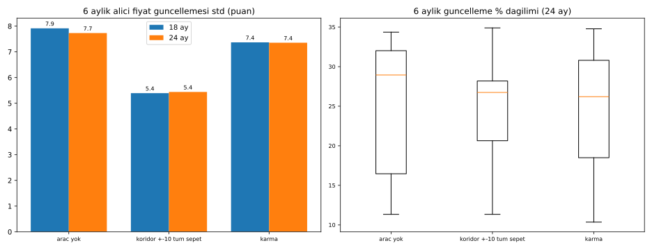

# Grup Bazlı Karma Oynaklık Yapısı (Fon + Tampon Stok + CPWD)

**Karar (sahip):** "Fon sadece sınırlı tedarik olan ürünlerde işe yarar; alt ve çoklu üretilenler stoklanabilir; geri kalanı ise CPWD yeterli."

Kod: [`oynaklik_karma.py`](oynaklik_karma.py). Veri:
- [`data/oynaklik_karma_ozet.csv`](data/oynaklik_karma_ozet.csv)
- [`data/oynaklik_karma_paylar.csv`](data/oynaklik_karma_paylar.csv)
- [`data/oynaklik_karma_backtest.csv`](data/oynaklik_karma_backtest.csv)

## 1. Kalem → araç eşlemesi

| Araç | Kalemler | Modeldeki parça | Maliyet içindeki payı (Ara 2019 → Ara 2025) | Endeks |
|---|---|---|---|---|
| **Koridor + istikrar fonu** (yalnız sınırlı tedarik) | PVC reçine, birincil alüminyum, otomasyon/elektronik, hurda (G3 kalanı); ithal kompresör, bakır ve motor payı (Y kalemlerinin ithal bileşeni) | G3 kalan + Y ithal bileşen | %10,5 → %8,4 | Kur ve malzeme karması; alıcıya 6 ayda bir trend ±10 puan |
| **KOBİ öncelikli tampon stok** (temel ve çoklu üretilen) | Çimento, agrega, inşaat demiri, tuğla/gazbeton, seramik, hazır beton girdisi; stoklanabilir Y kalemleri | G1'in stoklanabilir yarısı (VARSAYIM %50) | %21,2 → %20,8 | Malzeme endeksi; stoktan koridor fiyatıyla tedarik |
| **CPWD formülü**: V = P×Q×(I−I₀)/I₀, 3 aylık ortalama endeks, %15 sabit pay | Stoklanamayan G1 (hazır beton hizmeti, doğrama işçiliği girdisi, boya vb.); Y kalemlerinin yerli kısmı (kombi, asansör, kule vinç, beton pompası, yalıtım, kablo gövdesi); kalan G2 makine ve teçhizat | G1 stoklanamayan + Y yerli + G2 kalan | %30,6 → %29,2 | Malzeme veya kur endeksi, 3 aylık ortalama |
| Maliyet bazlı (mevcut kural) | İşçilik | İşçilik | %37,7 → %41,5 | İşçilik endeksi |

Payların kaynağı: orta senaryo ağırlıkları (girdi %65 / işçilik %35; girdi içinde G1 %70, G2 %10, G3 %20; Y = girdinin %16'sı). Hepsi önceki çalışmalardaki **VARSAYIM**lardır. Kalemlerin parçalara atanması bir karardır; ayrıntılı kalem payları modelde yoktur.

## 2. Varsayımlar
- Koridor δ = ±10 puan; trend, son 24 ayın ortalama 6 aylık değişimidir (VARSAYIM; OYNAKLIK_ARACLARI.md'deki en dengeli değer).
- Tampon stok 3 aylık tüketim kadardır; taşıma maliyeti yıllık %7 reeldir (VARSAYIM). Platform, gerçek fiyat ile koridor fiyatı arasındaki farkı da üstlenir.
- CPWD %15 sabit pay kaynaklıdır: 10CC'de W = 0,85 × M. 3 aylık ortalama endeks de CPWD uygulamasından alındı.
- %30 tavan bütün yapılarda uygulanır. Alıcı fiyatı, müteahhit gelirinin araç endeksleriyle ölçeklenmiş halidir; fark fondan ödenir.

## 3. Karşılaştırma (orta senaryo, Aralık 2019–Aralık 2025 kohortları)

| Teslim | Yapı | 6 aylık güncelleme std (puan) | Ort. güncelleme | Kohort CV | Alıcı fiyatı (birim maliyet = 1) | Müteahhit marjı (ort./min) | Zarar eden kohort | Fon ort. / maks (birim maliyetin %'si) | Stok maliyeti ort. / maks |
|---|---|---|---|---|---|---|---|---|---|
| 18 ay | Araç yok | 7,9 | %24,6 | 0,087 | 1,812 | %30 / %30 | 0 | 0 / 0 | 0 / 0 |
| 18 ay | Koridor ±10, tüm sepet | **5,4 (−32%)** | %23,6 | 0,084 | 1,776 | %30 / %30 | 0 | 3,6 / **24,1** | 0 / 0 |
| 18 ay | **Karma** | 7,4 (−7%) | %23,5 | 0,086 | 1,809 | %30 / %30 | 0 | **0,3 / 4,4** | 0,6 / 4,0 |
| 24 ay | Araç yok | 7,7 | %25,4 | 0,098 | 2,093 | %30 / %30 | 0 | 0 / 0 | 0 / 0 |
| 24 ay | Koridor ±10, tüm sepet | **5,4 (−30%)** | %24,5 | 0,107 | 2,044 | %30 / %30 | 0 | 5,0 / **27,1** | 0 / 0 |
| 24 ay | **Karma** | 7,4 (−5%) | %24,6 | 0,102 | 2,089 | %30 / %30 | 0 | **0,3 / 4,6** | 0,8 / 4,7 |

Not: Buradaki "tüm sepet" koridoru her parçaya ayrı ayrı ve işçiliği de kapsayarak uygulandı. Bu nedenle OYNAKLIK_ARACLARI.md'deki tek endeksli sonuçtan (6,6 puan) farklıdır.

## 4. Yorum
1. **Fon yükü yaklaşık 6 kat azalıyor:** azami yük birim maliyetin %24–27'sinden %4–5'ine iniyor. Bunun nedeni, fonun yalnız sınırlı tedarik payını (maliyetin yaklaşık %8–11'i) taşıması. Sahibin "fon sadece sınırlı tedarikte işe yarar" kararı, fon riski açısından doğrulanıyor.
2. **Oynaklık azalışı küçük (−5 ile −7%).** Sebepler:
   - İşçilik (maliyetin %38–42'si) maliyet bazlı kalıyor.
   - CPWD'nin 3 aylık ortalaması 6 aylık adımda az yumuşatma sağlıyor.
   - Stok, malzemenin yalnızca yaklaşık %21'ini kapsıyor.
   Daha fazla azalış için ya stoklanabilir pay büyütülmeli ya da işçilik veya CPWD kısmına da bant konmalı. İkincisi fon yükünü yeniden artırır.
3. **Müteahhit marjı %30, zarar eden kohort yok.** Yüksek enflasyonda %30 tavan bağlayıcı olduğu için CPWD'nin %15 sabit payı müteahhidi zarara sokmuyor. Bu, 2019–2025 verisine özgü bir sonuçtur. Düşük enflasyonda %15 sabit pay müteahhide risk aktarır.
4. **Stok maliyeti** ortalama %0,6–0,8, en fazla %4–5. Bu, platformun karşı döngüsel fiyat farkı ve taşıma yüküdür.
5. **Alıcı fiyatı** araç olmayan durumla neredeyse aynı (−%0,2). Karma yapı fiyat seviyesini değiştirmeden fon riskini sınırlıyor.

## 5. Eksikler
- Kalem bazında gerçek maliyet payları (PVC, alüminyum, elektronik vb.) yok; parça payları varsayım.
- Stoklanabilir payın %50 olması ve stok taşıma maliyeti varsayım.
- Türkiye'de CPWD tipi bir resmi kalem endeksi seti (Schedule F muadili) yok; TÜİK malzeme endeksi ve kur kullanıldı.
- Fonun ve stokun finansman kaynağı modellenmedi.
