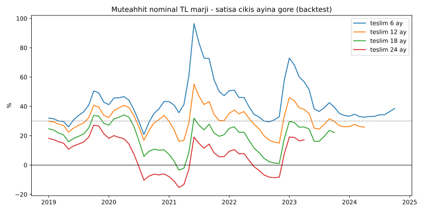
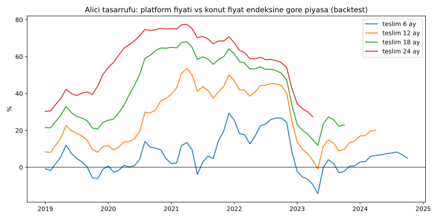
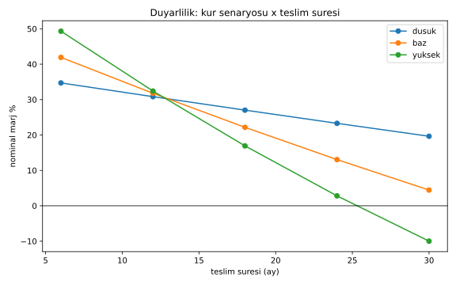
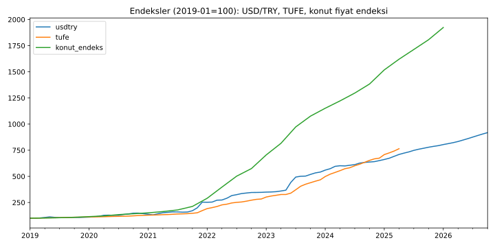

# Fiyat Kuralı Simülasyonu (Backtest)

Kod: [`simulasyon.py`](simulasyon.py) · Veriler: [`data/`](data/) · Çalıştırma: `python3 simulasyon.py`

## 1. Test edilen kural ve varsayımlar

**Kural (kullanıcı tanımı):** Genel kâr marjı üst sınırı **%30**. Dolar bazlı maliyet 100.000 $ ise satış fiyatı **130.000 $**.

**Yorum (varsayım):** Satış fiyatı ilk **6 ay** boyunca USD/TRY kuruna endekslidir (TL fiyat = 130.000 $ × o ayın kuru); 6. ayın kuru ile TL olarak **sabitlenir** ve sonrasında değişmez.

| Varsayım | Değer | Not |
|---|---|---|
| Temsili konut | ~100–120 m², toplam maliyet 100.000 $ | Kullanıcı örneği; m² maliyeti verisi kullanılmadı |
| Maliyet dağılımı | %65 işçilik hariç girdi, %35 işçilik | **Varsayım** (resmî kırılım çekilemedi) |
| Girdi maliyeti seyri | USD/TRY ile birebir (dolar bazlı) | **Varsayım** — TÜİK İnşaat Maliyet Endeksi yerine |
| İşçilik maliyeti seyri | TÜFE ile | **Varsayım** — TÜİK işçilik alt endeksi yerine |
| Harcama zamanlaması | Maliyet inşaat süresine (teslim süresi) eşit yayılır | Varsayım |
| Tahsilat | Fiyat teslimde tahsil edilir; teslim < 6 ay ise teslim ayındaki kur | Varsayım (ön satış/taksit modellenmedi) |
| Piyasa karşılaştırması | Satışa çıkış ayında platform fiyatı = piyasa fiyatı kabul edilir; piyasa fiyatı sonra konut fiyat endeksiyle büyür | Varsayım — mutlak TL/m² verisi yok |
| Kohort | 2019-01'den itibaren her ay satışa çıkan bir konut | Veri bitişine kadar |
| Teslim süreleri | 6, 12, 18, 24 ay | |

**Marj tanımları:** *Nominal marj* = TL fiyat / TL olarak harcanan toplam maliyet − 1. *USD marjı* = (TL fiyat / teslim ayı kuru) / 100.000 $ − 1 (dolar bazında reel getiri).

## 2. Veri kaynakları

| Veri | Kaynak | Kapsam (bu çalışmada) | Erişim |
|---|---|---|---|
| USD/TRY günlük kur (aylık ortalamaya çevrildi) | Frankfurter API (Avrupa Merkez Bankası referans kurları) — `api.frankfurter.app` | 2019-01 → 2026-10 | 25.10.2026 |
| Türkiye TÜFE (2015=100) | OECD, FRED serisi `TURCPIALLMINMEI` | → 2025-04 | 25.10.2026 |
| Türkiye nominal konut fiyat endeksi (çeyreklik, aylığa doğrusal enterpolasyon) | BIS, FRED serisi `QTRN628BIS` | → 2026-Ç1 | 25.10.2026 |

**Eksikler (uydurulmadı):**
- **TCMB EVDS** (kur, Konut Fiyat Endeksi, TL/m² birim fiyat): API anahtarı gerektiriyor, çekilmedi. Yerine ECB kuru ve BIS konut endeksi kullanıldı.
- **TÜİK İnşaat Maliyet Endeksi** (malzeme/işçilik): otomatik çekilemedi. Yerine girdi = USD/TRY, işçilik = TÜFE varsayımı.
- **Çevre, Şehircilik ve İklim Değişikliği Bakanlığı yapı yaklaşık birim maliyetleri**: çekilmedi; mutlak m² maliyeti yerine 100.000 $ örneği kullanıldı.
- TÜFE verisi 2025-04'te bittiği için backtest kohortları en geç bu tarihe kadar tamamlanan dönemleri kapsar.

## 3. Sonuçlar — Backtest (2019-01'den itibaren aylık kohortlar)

| Teslim süresi | Kohort | Ort. nominal marj | Min | Maks | Zarar eden kohort | Ort. USD marjı | Ort. alıcı tasarrufu | Tasarruf aralığı |
|---|---|---|---|---|---|---|---|---|
| 6 ay | 70 | %42,8 | %20,9 | %96,5 | 0 | %30,0 | %6,5 | −%14,3 … %29,4 |
| 12 ay | 64 | %30,8 | %15,0 | %55,1 | 0 | %10,3 | %25,8 | −%0,9 … %53,7 |
| 18 ay | 58 | %19,2 | −%3,4 | %34,2 | 2 | −%7,8 | %42,2 | %11,9 … %68,0 |
| 24 ay | 52 | %7,4 | −%15,3 | %27,2 | 17 | −%24,6 | %57,2 | %27,4 … %77,5 |

**Okuma:**
- Nominal marjın 6 ayda %30'u aşması, maliyetlerin ilk aylarda daha düşük kurdan harcanıp gelirin 6. ay kuruyla alınmasından kaynaklanır (endeksleme dönemi müteahhidin lehine).
- Sabitlemeden sonra marj hızla erir: dolar bazında ortalama marj 12 ayda %10,3'e, 18 ayda −%7,8'e, 24 ayda −%24,6'ya düşer.
- **Nominal TL zararı:** 18 ay teslimde 2 kohort (2021-03 ve 2021-04 başlangıçlı), 24 ay teslimde 17 kohort (başlangıçlar 2020-07 ile 2022-11 arasında; 2021 kur şoku ve 2022 enflasyonu dönemi).
- **Alıcı tarafı:** Piyasa konut fiyatları kurdan ve TÜFE'den hızlı arttığı için, sabit fiyat alıcıya teslimde ortalama %26 (12 ay) – %57 (24 ay) avantaj sağlar. Bu tasarruf büyük ölçüde müteahhidin erimiş marjından gelir.

## 4. Duyarlılık — Kur senaryosu × teslim süresi (sentetik, ileriye dönük)

Senaryolar **varsayımdır**: aylık kur artışı düşük %1, baz %2,5, yüksek %4; TÜFE aylık artışı = kur artışının 0,9 katı.

| Teslim | Düşük nominal / USD | Baz nominal / USD | Yüksek nominal / USD |
|---|---|---|---|
| 6 ay | %34,7 / %30,0 | %41,9 / %30,0 | %49,3 / %30,0 |
| 12 ay | %30,8 / %22,5 | %31,8 / %12,1 | %32,4 / %2,7 |
| 18 ay | %27,0 / %15,4 | %22,2 / −%3,3 | %16,9 / −%18,8 |
| 24 ay | %23,3 / %8,7 | %13,1 / −%16,6 | %2,8 / −%35,8 |
| 30 ay | %19,6 / %2,4 | %4,4 / −%28,1 | −%10,0 / −%49,3 |

Yüksek kur senaryosunda 30 ay teslimde nominal TL zararı oluşur; dolar bazında baz senaryoda 18 aydan itibaren zarar başlar.

## 5. Modelin zayıf noktaları

1. **Sabitleme sonrası kur/enflasyon riski tamamen müteahhide kalıyor**; teslim süresi 12 ayı aştığında marj sistematik olarak eriyor, 18–24 ayda zarar olası. Bu, ya kalite düşürme (standartla çelişir) ya da projeyi yavaşlatma/terk etme teşviki yaratır.
2. **İlk 6 ay endeksleme müteahhide fazla kazanç veriyor** (kısa teslimde nominal marj %30 tavanını aşıyor); tavan fiilen delinmiş oluyor.
3. **Alıcı tasarrufu yüksek ama kırılgan**: tasarruf, müteahhidin zararı pahasına geliyor; sürdürülebilir değil.
4. Piyasa fiyatına göre büyük fark, ikincil piyasada **arbitraj** (ucuz alıp piyasa fiyatından satma) riski doğurur.
5. Veri sınırları: girdi maliyeti için kur, işçilik için TÜFE vekil olarak kullanıldı; gerçek inşaat maliyet endeksi farklı seyredebilir.

## 6. Önerilen düzeltmeler (test edilmedi — sonraki iterasyon)

- **Kısmi endeksleme:** 6 ay sonrası tam sabit yerine, kalan bakiyenin örn. inşaat maliyet endeksine kısmi (belirlenecek oranda) bağlanması.
- **Hakediş/kademe bazlı fiyat:** Fiyatın inşaat ilerleme aşamalarına göre tahsil edilmesi; tahsil edilen kısım sabitlenir, kalan kısım endekslenir.
- **Tavan + taban bandı:** Marj için yalnız üst sınır değil, maliyet şoklarında alt koruma (örn. dolar bazında asgari marj).
- **Teslim süresine bağlı sabitleme:** Sabitleme anını satışa çıkıştan değil, belirli bir yapım ilerlemesinden başlatmak.
- **Endeksleme döneminde tavanın USD yerine TL maliyet üzerinden hesaplanması** (6 ay içindeki aşırı kazancı keser).
- **Kur riskinin paylaşımı:** Platform/yerli tedarik çerçeve sözleşmeleriyle girdi fiyatlarının sabitlenmesi (Bölüm 10 ile uyumlu).
- **İkincil satış kısıtı:** Belirli süre devir yasağı veya kâr payı geri alımı.
