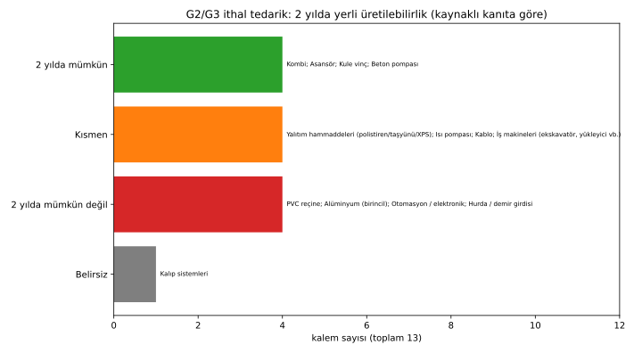

# 2 Yılda Yerli Tedarik: G2/G3 İthal Kalemlerin Kaçı Üretilebilir?

Veri: [`data/yerlilestirme_2yil.csv`](data/yerlilestirme_2yil.csv) · Grafik: [`grafik_yerlilestirme_2yil.svg`](grafik_yerlilestirme_2yil.svg)

**Sınıflandırma ölçütü:**
- **2 yılda mümkün:** Yerli üretici/kapasite zaten var; sorun kapasite tahsisi ve teşvik.
- **Kısmen:** Nihai ürün yerli üretiliyor, ancak kritik hammadde veya bileşen ithal.
- **2 yılda mümkün değil:** Hammadde/teknoloji tesisi yok veya durmuş, ve açıklanmış yatırım 2 yıl içinde kapasite getirmiyor.
- **Belirsiz:** Kaynaklı kanıt bulunamadı.

Not: Tipik tesis kurulum süresi için kaynaklı veri **bulunamadı**. Sınıflandırma, mevcut kapasite ve açıklanmış yatırım takvimine dayanır.

## Sayım (13 kalem)

| Sınıf | Sayı | Kalemler |
|---|---|---|
| 2 yılda mümkün (yerli üretim zaten var) | **4** | Kombi, asansör, kule vinç, beton pompası |
| Kısmen | **4** | Yalıtım hammaddeleri, ısı pompası, kablo, iş makineleri |
| 2 yılda mümkün değil | **4** | PVC reçine, birincil alüminyum, otomasyon/elektronik, hurda/demir girdisi |
| Belirsiz | **1** | Kalıp sistemleri |

## Kalem bazında

| Kalem | Sınıf | Mevcut yerli üretim / kapasite | Açıklanmış yatırım | Engel | Kaynak |
|---|---|---|---|---|---|
| PVC reçine | Mümkün değil | Petkim 150 bin t/yıl tek üretici; VCM tesisi ticari olarak durmuş, PVC ithal VCM ile; 2023 PVC ithalatı 936 bin t | Petkim Master Plan yalnızca etilen/PP/PE (~5 milyar $). FEED 2027 sonu, nihai yatırım kararı 2027'de değerlendirilecek. PVC/VCM kapasite artışı **açıklanmamış** | VCM/PVC lisanslı teknoloji (eski tesisin lisansörü Solvay) | Petkim 2025 Entegre Rapor; Petkim 2Ç26 sunumu; Petkim FEED bülteni; Alarko |
| Birincil alüminyum | Mümkün değil | Eti Alüminyum 82 bin t; talebin %91,2'si (1,85 Mt) ithal | Birincil kapasite planı yok (Bakanlık yol haritası 2053'e kadar sabit varsayıyor). 3 milyar TL haddehane (100 → 200–250 bin t) yalnızca yarı mamul | Enerji yoğun elektroliz | Sanayi ve Teknoloji Bakanlığı yol haritası; Ekonomim; Fuar Dergisi |
| Yalıtım hammaddeleri | Kısmen | Polistiren: yerli 150 bin t, tüketim 320 bin t, ithalat 170 bin t (2024). Yalıtım ürünleri üretimi 1,53 Mt, ithalat 100,6 bin t (2024). İzocam taşyünü 130 bin t, XPS 720 bin m³ | — | Polistiren hammaddesi | Ekonomim (DİOKİ); Şantiye Dergisi; İzocam |
| Isı pompası | Kısmen | Mitsubishi Electric Manisa 300 bin adet/yıl (2025); COPA Bursa 100 bin adet/yıl; Form yerli su kaynaklı | COPA 3,5 milyon € | Kompresör, bakır boru, otomasyon ithal | DTK; MACT; Dünya |
| Kombi | Mümkün | 2,5 milyon+ adet/yıl, yarısı ihraç | — | Gaz valfi, fan, pompa, eşanjör, sensör ithal (2016 kaynağı) | Ekonomim; Doğalgaz Dergisi |
| Asansör | Mümkün | İhracat 334 mn $, dünya 9. (2024); 2.068 firma | — | Bileşen ithalat payı bulunamadı | AYSAD 2024 |
| Kablo | Kısmen | İhracat 2,51 milyar $ (Ocak–Ağustos 2025) | — | Bakırda ~%80 dışa bağımlılık | TET; Dünya; IICEC |
| Otomasyon/elektronik | Mümkün değil | İthalat payı ~%55–65 (kontrol istasyonu), ~%80–85 (proses otomasyonu), IndexBox tahmini; yerli PLC üreticisi var (GMT) | — | Yarı iletken (2018: ithalat 217,7 mn $ / ihracat 16 mn $) | IndexBox; Kalkınma Kütüphanesi; GMT |
| Kule vinç | Mümkün | 5 yerli üretici, 11 ülkeye ihracat, ~3 bin adet üretilmiş; TGM %80 yerli malzeme (2019) | — | Tahrik parçaları kısmen ithal | Türkiye'de İş Dünyası; TGM; Pi Makina |
| Kalıp sistemleri | Belirsiz | Bulunamadı | — | — | — |
| Beton pompası | Mümkün | Pi Makina yerli; 2023 ihracat 825 adet / 78 mn $ > ithalat 507 adet / 72 mn $ | — | — | IndexBox; Pi Makina |
| İş makineleri | Kısmen | İthalat 1,767 > ihracat 1,261 milyar $ (2025 ilk 8 ay); yerli üreticiler var | — | Bileşen oranı bulunamadı | İMDER; Pi Makina |
| Hurda/demir girdisi | Mümkün değil | Ham çeliğin %86,8'i hurda bazlı; hurda ithalatı 18,77 Mt | İkame (DRI vb.) yatırımı bulunamadı | Hurda yan ürün; arz stoka bağlı | TÇÜD; BIR/steelorbis |

## Model için sonuç
- **4 kalem (kombi, asansör, kule vinç, beton pompası):** Yerli girdi şartı 2 yıl içinde uygulanabilir. G2'deki kule vinç ve beton pompası, kiralama havuzunda yerli üreticiden tedarik edilebilir.
- **4 kalem kısmen:** Nihai ürüne yerli şart konabilir; hammadde/bileşen (polistiren, kompresör, bakır, hidrolik) için geçici istisna ve karışık endeks (G3) sürer.
- **4 kalem 2 yılda mümkün değil:** Kur endeksli/ithal kalır. Uzun vadeli yatırım gerekir: PVC/VCM, birincil alüminyum, yarı iletken. Hurda ise yapısal bir sorundur.

## Eksikler
- Kalıp sistemleri üretim verisi.
- Tipik tesis kurulum süreleri ve kalem bazlı yatırım tutarları.
- Kombi ve asansörde güncel bileşen ithalat oranı.
- İş makinelerinde motor/hidrolik yerli payı.
- Otomasyon için resmî (TÜİK) ithalat payı: yalnızca IndexBox tahmini bulundu.
